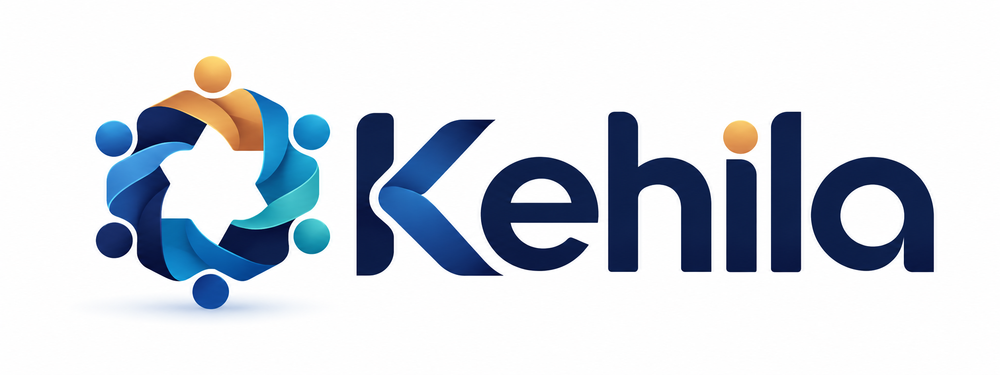

<p align="center">
  
</p>

# Kehila — Project and task management


Kehila is an open-source project management system in early development, designed
around custom fields and real-time updates. This repository currently contains
a Rust query parser, NATS connection checks, shared synchronization types, pure
rules for the configurable project and WorkItem model, and an authenticated Rust
authority with native PostgreSQL persistence and a first-party development
interface. Its bounded slice includes project creation and Task/Milestone
create/read/list, text/estimate edits, pending creation and identity-preserving
retry/reconciliation. There is no supported installation or
real-data readiness claim; actual browser qualification remains deferred.

The project and repository were renamed to Kehila on 2026-10-04. Package/import
names now use `kehila`, and launch variables use `KEHILA_*`. Existing development
storage and machine identifiers are retained to preserve data; see the
[rename and storage notes](docs/BRANDING.md#rename-and-retained-storage-identities).

## Current components

| Component | Available today |
| --- | --- |
| Rust query parser | Parses a single equality filter, such as `status = 'Open'` |
| Rust NATS connection | Connects to a broker and checks protocol round trips |
| Go synchronization rules | Checks whether a query can run at the current schema version |
| Rust project and WorkItem contract | Pure typed rules for project creation, configuration, fields, conversion, selection, estimates, knowledge, relationships, provenance and scoped replay/expiry with tombstones; the native authority connects a selected persistence slice |
| Rust native product authority | Authenticated Project/Task/Milestone creation and reads, bounded item lists, text/estimate edits, pending-creation cancellation and identity-preserving recovery; fresh synthetic development profile, with actual browser qualification deferred |
| TypeScript contracts | Shared type declarations; no JavaScript runtime |
| Development services | PostgreSQL, OpenSearch and NATS in Compose; native qualification owns a separate isolated PostgreSQL TLS fixture |

See [implementation status](docs/IMPLEMENTATION.md) for limitations and planned work.

## Product planning

The [product plan](docs/product/README.md) records the agreed
requirements for local task tracking, shared resources, scheduling, and costs.
It includes decisions, open questions, and a requirement-linked implementation
backlog. Planned capabilities are not claims of currently available features.
The [B-003 contract](docs/product/B-003-contract.md) records the accepted
project and WorkItem rules and their pure checks. The
[M1 slices](docs/product/backlog.md#m1-configurable-model) track storage, access,
API, and interface implementation of that model.

The [WorkItem action stacks proposal](docs/design-proposals/action-stacks-proposal.md)
describes planned dependency-graph execution, workflow gates, and persistent
artifacts. It records future feature direction; technical contracts and delivery
remain pending, with no change to the existing M1 scope.

## Development setup

Backend host platforms target Windows and Linux; macOS and other host operating
systems are unsupported ([D-036](docs/product/decisions.md#d-036)). This scope
does not establish production deployment readiness or restrict browser clients.
On Linux installations without a `python` command, use `python3` in the commands
below. The Git verification launcher accepts either name for Python 3.10+.

Install Python 3.10+, Git, Rust stable, Go 1.22+, and Podman or Docker with a
Compose provider. The development services use ports 5432, 4222, 8222 and 9200.
Choose explicit host/runner resource bounds for container verification; the
runner limit excludes the VM and services. Initial image pulls need Internet access.
No third-party Python packages are required. npm/pnpm is optional for the
declarations-only JavaScript workspace.

From a checkout:

```text
python scripts/setup_env.py --hooks-only
python scripts/verify.py
```

The shared host matrix builds with one compiler job before starting short-lived,
owned service groups. It removes each group after its checks. Keep the listed
ports free; existing development containers are not borrowed or stopped.
On Windows, `python scripts/verify.py --engine podman --podman-machine NAME`
starts an explicit stopped VM after builds and retains it as shared. Add
`--exclusive-podman-machine` only for an initially stopped VM reserved exclusively
for the run, allowing automatic cleanup and shutdown.
Host service checks require default local endpoints, including with `--external-services`.
See [test lifecycle and hook settings](docs/TESTING.md#owned-test-services).
Native capability qualification additionally requires the exported-source
container fixture and independent SQL observers. The full container gate and
required native CI job retain that coverage; host service readiness alone does
not establish it. See the [native implementation evidence](docs/implementation/native-work-items.md)
and [prototype retirement record](docs/implementation/ferretdb-retirement.md).
OpenSearch requires `vm.max_map_count` of at least 262144 on the Linux host or
VM. CI configures this in its disposable runner.

For unit tests without containers:

```text
python scripts/verify.py --pure
```

For a development stack that stays running, use `python scripts/setup_env.py --start`,
then `python scripts/verify.py --external-services`. That mode retains
all checks and leaves the stack under your ownership. Inspect or stop it with:

```text
podman compose -f docker-compose.yml logs
podman compose -f docker-compose.yml stop
```

Use `docker compose` if you started the stack with Docker. Existing experimental
records and retained volumes are preserved; retirement does not import them into
the native development profile. Read [SECURITY.md](SECURITY.md)
before changing network exposure or using real data.

## Parser example

The `kehila_query` crate accepts a single equality expression:

```rust
use kehila_query::parse_filter;

let filter = parse_filter("status = 'Open'").unwrap();
assert_eq!(filter.field, "status");
assert_eq!(filter.value, "Open");
```

Identifiers use ASCII letters, digits, and underscores and cannot start with a
digit. Values are nonempty single-quoted strings. Compound expressions and
escaped quotes are not supported yet.

This is Kehila's own filter grammar. Jira Query Language (JQL) compatibility is
not a current feature or requirement. See the [naming and third-party reference
policy](docs/BRANDING.md) for terminology and compatibility claims.

## Architecture direction

The implemented M1 slice uses an authenticated Rust authority and native
PostgreSQL. NATS event delivery, OpenSearch projections and the broader query
compiler remain separate integration work; native saves and authoritative reads
do not depend on those services. The first-party interface currently exposes
the bounded project and WorkItem development capability.

The [v0.2 design](docs/reference/Kehila-v0.2.md) remains a historical design input.
Accepted [architecture records](docs/architecture/README.md), including native
storage and owner authority, supersede its earlier storage/API direction.
Deployment, supported upgrades and real-data use still require their own evidence.

## Contributing

The [Engineering Standard](docs/engineering/ENGINEERING-STANDARD.md) defines
evidence-based E1–E5 Engineering Preview through Enterprise gates. Kehila remains
Experimental; the backlog's product milestones are separate. See the
[architecture records](docs/architecture/README.md) and
[Definition of Done](docs/engineering/DEFINITION-OF-DONE.md) for change governance.
The [Coding Standard](docs/engineering/CODING-STANDARD.md) applies design and
language conventions to new/materially changed code, with existing gaps recorded.

Use the [project procedure index](docs/procedures/README.md) to find SOPs,
their approval status, and their enforcement coverage.

See [CONTRIBUTING.md](CONTRIBUTING.md) for contribution requirements and
[docs/TESTING.md](docs/TESTING.md) for test commands and the
[test strategy](docs/TEST_STRATEGY.md) for the longer-term quality approach.
Report vulnerabilities as
described in [SECURITY.md](SECURITY.md).

Code is licensed under Apache-2.0. The Code of Conduct retains its upstream
Contributor Covenant attribution.

Kehila is an independent project and is not affiliated with, sponsored by, or
endorsed by Atlassian. Jira is a trademark of Atlassian.
