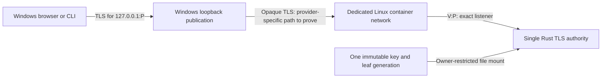

# ADR-106 - Local container transport and disposable server-key delivery

Status: Proposed. Owner: project maintainer. Created / reviewed: 2026-10-22.
Acceptance: pending; neither PR merge nor probe success accepts this amendment.
Related: [ADR-105](ADR-105-local-owner-authentication.md),
[B-007](../product/backlog.md#b-007), [#40](https://github.com/MrQuality/kehila/issues/40),
[#49](https://github.com/MrQuality/kehila/issues/49), D-036/D-037;
[design and proposed probe](../implementation/local-owner-authentication-container-plan.md).

## Context and authority

The maintainer requested a reviewable remaining-A0 design for the Linux-container
backend, Windows MVP client path, server-key lifecycle and a bounded next proof.
The [framing record](../implementation/local-owner-authentication-container-plan.md#framing-and-decisions)
separates that authorization from these proposed choices and execution permission.
The accepted source baseline is `8b13fd34625b799824a8422b5c24db799955243c`.

On 2026-10-22 the maintainer selected same-host Podman with WSL 2 as the first-proof
topology: Windows client, Linux-container backend, WSL infrastructure. This selects
the research/proof target, not this listener amendment or storage risk. The
[read-only feasibility result](../implementation/local-owner-authentication-podman-feasibility.md)
leaves resume readiness unresolved; no executable proof is authorized.

ADR-105 requires HTTPS termination and authority in one Rust process, and says
both the client origin and listener are literal `127.0.0.1`. Host and container
loopback are different boundaries. A host port declaration alone does not prove
access to a container-loopback listener or confinement at the Windows/VM boundary.
AUTH-001's existing host-only evidence and bind checks remain valid for that scope.

## Proposed decision and exact amendment

Recommend an additional, explicitly selected container profile. If accepted,
this would amend only ADR-105 section 1's listener-address rule for that profile:

- Client origin remains exactly `https://127.0.0.1:P`, for one configured port
  above 1023. The certificate retains the agreed exact IP SAN, TLS 1.3 and normal
  verification. No container IP, DNS alias or LAN origin becomes a client identity.
- Publish only Windows `127.0.0.1:P` through the qualified Podman/VM path to one
  configured container IPv4 address `V:P` on a dedicated rootless bridge. Rust
  binds that specific assigned address, never a wildcard. A conflicting subnet,
  unexpected interface/address or additional publication fails preflight.
- Separate trusted `PublicOrigin` from `ListenAddress`; request headers cannot
  configure either. The probe plan defines required, unique `--listen-addr` and
  `--public-origin` arguments, canonical grammar and pre-bind validation, without
  fallback configuration sources. Exact Host/Origin admission uses the former, not `V` or a
  forwarded header. The Rust process terminates TLS; forwarding carries opaque
  TLS bytes and receives no TLS key or authority role. No HTTP or TLS-terminating
  proxy is introduced. Source IP is not caller identity.
- Host-network mode, shared pod/network namespaces, unrelated peers on the bridge,
  automatic forwarding changes and privileged containers are outside the profile.
  Engine/VM administration is trusted and can defeat these restrictions; this is
  not a hostile-engine boundary. Ordinary local callers still require future
  authentication, even though they can reach the Windows loopback endpoint.

This is a proposed change to reachability, not a reinterpretation that the current
ADR already permits it. The allowed/denied path matrix in the probe plan must pass
on the selected Windows provider before any qualification. A failed direct-access
isolation test blocks this profile; it does not authorize broader VM/LAN exposure.
ADR-105 remains Accepted and unchanged while this record is Proposed.

## Proposed key delivery: disposable proof only

Recommend a uniquely named Podman mounted secret containing one complete leaf and
PKCS#8 key generation, read once with a 64 KiB maximum. Require exactly one leaf
and matching key in the plan's exact version-1 ASCII PEM grammar: certificate
first, unencrypted PKCS#8 key second, complete DER consumption. Reject extra
objects, unknown material and non-whitespace tails; parser API selection and
negative tests remain gates, not implemented guarantees.
Rootless engine ownership and container UID/GID mappings must be measured.
Propose container UID/GID `10001:10001`, secret mode `0400`, read-only root,
all Linux capabilities dropped, no new privileges and no engine socket in the
container.
These settings are acceptance criteria, not proof of safe opening or protection.

Use the file secret driver only for disposable values after explicit review of
its residual risk: its documented read-protection is not at-rest encryption.
Engine owner, VM/host administrators and retained disk/backup copies can expose
keys. No copied-record protection, secure erasure or production storage adoption
is claimed. If that threat must be covered by this proof, stop and review an
encrypted storage/unlock contract instead. Windows DPAPI is not this backend's
storage model; the existing Windows CLI contract remains distinct.

Keep the issuer signing key with the operator, outside the serving container and
its secret store. Import the reviewed bundle through an approved local engine
channel with no secret in arguments, environment, image, build context or logs.
Use a new secret ID per generation; do not overwrite a live record or rely on
hot-update semantics. Stop/remove the old container, then create the new one with
one explicitly selected generation. Persist owned operation intent before mutation;
ambiguous recovery stops for reconciliation. The plan defines each crash point.

## Alternatives and reasons

| Option | Assessment for this proposal |
| --- | --- |
| Container-loopback listener plus ordinary port publication | Preserves the literal bind rule, but the source material does not establish a complete reachable Windows path. Not a qualified baseline. |
| Opaque TCP relay to container loopback | Keeps Rust TLS termination; needs another listener/process and bounded buffering, admission, shutdown and keyless relay review. Reconsider if the direct profile cannot meet isolation criteria; no automatic fallback. |
| VM host network / shared pod | Adds shared-network reachability and interference; not the selected isolated profile. |
| TLS-terminating reverse proxy | Changes the accepted Rust TLS/authority boundary and adds authenticated forwarding/trust work. No demonstrated need justifies it here. |
| Linux-owned generation files on a volume | Viable storage alternative; needs protected creation, safe opened-object checks, atomic generation selection and crash/durability evidence. More application-owned file operations for this proof. |
| Windows bind-mounted key / GPG-backed secret | Windows filesystem translation or encrypted-store unlock adds a separate contract. Neither is selected merely for convenience. |

## Consequences and follow-up

A direct profile avoids an extra application relay but enlarges the Rust socket's
network scope. Accepting that trade-off requires explicit maintainer acceptance
and actual isolation evidence. Downtime during generation replacement is allowed
for this diagnostic proof. Later authenticated restart loses sessions under
ADR-105; no transparent renewal/session continuity is claimed. Host suspend or
VM suspension/freeze/restore must end the diagnostic instance before application
work resumes. The probe plan requires pause-inclusive lifetime/expiry accounting
and a proven resume admission barrier; provider/API feasibility remains a gate
before executable approval, not evidence supplied by this proposal.

The proof does not qualify Linux-host clients, Windows CLI bearer storage,
supported installation, A1-A5, the production graph, ADR-103 or replicas (#65).
The container profile must be explicit: no global weakening of AUTH-001's host
loopback guard or anonymous prototype routes. Production integration remains gated.
Recovery (#60) needs stable identity and fresh enrollment after supported restore;
a TLS bundle is not actor identity or an identity backup. Languages (#61) do not
change canonical origin/identifiers. Agent execution (#62) needs future authority
contracts; diagnostic reachability grants no agent execution capability.

Verification: no new runtime/probe has been executed. Review sources, findings,
actual documentation checks and final revision in the implementing PR. The
[probe plan](../implementation/local-owner-authentication-container-plan.md) owns
numerical oracles, unresolved prerequisites and evidence limits under #40/#49.
