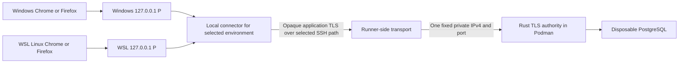

# ADR-110 GitHub hosted verification with local browser clients

Status: Proposed. Owner: project maintainer. Created: 2026-11-03.
Acceptance: pending an explicit maintainer decision; merging this proposal does
not authorize implementation, enrollment, trust changes or replacement of gates.
Related: [ADR-105](ADR-105-local-owner-authentication.md),
[ADR-106](ADR-106-local-container-transport.md),
[testing guide](../TESTING.md),
[research and risk plan](../implementation/hosted-verification-testbench.md).
Continuing obligations: [#40](https://github.com/MrQuality/kehila/issues/40),
[#41](https://github.com/MrQuality/kehila/issues/41),
[#49](https://github.com/MrQuality/kehila/issues/49) and
[#71](https://github.com/MrQuality/kehila/issues/71); none is completed here.

## Outcome and scope

Move backend compilation and service-backed verification away from a
memory-constrained development machine while preserving real Windows and Linux
browser testing. Use standard GitHub-hosted Linux capacity first; reconsider
paid runners or a cloud VM when observed capacity or operating costs justify it.
The initial deliverable was research, a design proposal and a risk management
plan for review, without executable changes. The maintainer subsequently
requested bounded feasibility experiments; [SP-007](../spikes/SP-007-hosted-testbench.md)
records that separate research scope and actual evidence. Experimental code does
not implement or accept this proposed architecture.

The proposed Linux frontend is the existing backend-served web interface in a
Linux Firefox or Google Chrome process running under WSL. A Windows browser
launched from a WSL shell is still Windows evidence. This proposal does not
create a native Linux desktop client or port the experimental Windows CLI.

## Context and consequential premises

Source baseline: `7f9301601c5de4c87f8cad7c3b1c1681d0769336`.

| Premise | Status and evidence | Consequence if false |
| --- | --- | --- |
| Backend execution can use hosted Linux containers | Established for current native CI: `.github/workflows/ci.yml` uses Podman; [merge CI](https://github.com/MrQuality/kehila/actions/runs/41696939042) passed. The separate shared job currently uses Docker. | Investigate the specific failing lane; do not introduce a local fallback. |
| Standard public hosted capacity is the initial target | Maintainer-selected starting point. [GitHub specifications](https://docs.github.com/en/actions/reference/runners/github-hosted-runners) list 4 CPUs, 16 GB RAM and 14 GB SSD for the selected x64 Linux class. | Reassess with measurements, including disk and cold preparation. |
| Local Windows and WSL browsers are needed | Maintainer request, including Firefox/Chrome on Linux and consideration of headless automation. | Hosted-only browser results cannot replace the requested local paths. |
| Existing product behavior can remain intact | Inference from `startup.rs`, `http_auth.rs` and relative same-origin requests in `listener/page.js`. The client origin remains `https://127.0.0.1:P`. | Reopen this design before changing product origin, TLS or authentication. |
| Same-PC transport approval covers a remote bench | Contradicted by ADR-106's explicit same-PC scope and external-ingress exclusion. | A separate disposable remote-test topology needs acceptance. |
| Free compute means a free complete bench | Unsupported: connectivity, quota, storage and administration are separate costs. | Obtain eligibility and cost acceptance before enrollment. |
| Hosted committed-source tests replace the staged local gate | Contradicted by the current `.githooks/pre_commit.py` index-tree contract. | Preserve the gate until a separate replacement proves exact-source binding. |

The existing native fixture owns a complete internal test lifecycle. It is not
a reusable backend session for external browsers. Current page tests simulate
the DOM; they do not establish browser, trust or remote-network behavior.

## Proposed decision

### Separate unattended verification from local client sessions

Retain ordinary PR/main verification without local-machine connectivity. Keep
its existing required checks. Containerized backend workloads in the new bench
use Podman; this proposal does not migrate the separate existing shared CI job.

Add a separately dispatched, bounded integration-session workflow only after
acceptance. It runs a fresh synthetic backend/database fixture on a hosted Linux
runner and serves sequential local browser cases. Use its own concurrency domain;
a new push must not implicitly cancel a human-assisted session. Concurrent
requests against the same fixture are allowed only in explicitly selected cases.
This is a testing session, never an always-on development or application server.

Initially use one browser and one test worker at a time. Propose stock Chrome
and Firefox on Windows and WSL, headless by default. Headed checks remain a
bounded final campaign where they establish behavior headless execution cannot.
A local browser/WSL still consumes local RAM; backend offload is expected to
reduce demand substantially, but its size is not yet measured.

### Preserve the application authority through an opaque connection

The maintainer selected SSH as the preferred research candidate on 2026-11-04.
The later [brokerless investigation](../implementation/hosted-testbench-direct-ssh.md)
evaluates direct local-to-runner and runner-to-local connections to reduce
operated infrastructure and cost. A broker is a comparison, not an assumed
requirement. The [SSH investigation](../implementation/hosted-testbench-ssh.md)
retains observed restriction gaps and experiments. Prior tsnet build
evidence remains historical comparison, not the current preferred direction.
No broker/provider, live topology or automatic fallback is accepted here.

Windows and WSL paths run separately; the diagram does not imply shared loopback
or simultaneous ownership of one port. The local connector binds only the exact
loopback endpoint and attaches only to the authenticated session mapping. It
opens no general SOCKS/HTTP proxy, remote shell or network control API. With a
direct local forward, a runner SSH server opens and restricts the exact authority
destination. With a runner-initiated reverse forward, the runner client opens
that destination and requires independent confinement; local/broker listener
restrictions alone cannot enforce the client-side target. Reachability and
ingress acceptance remain distinct for each direction.
No PostgreSQL, engine socket or arbitrary-destination reach is admitted. A
TLS-terminating proxy would change the application endpoint and is excluded.

The helper carries bytes, not HTTP credentials or application authority. Rust
still terminates browser TLS. Preserve the exact port, IP certificate identity,
Host/Origin, protected cookies, CSRF and product deadlines. No CORS expansion,
certificate bypass, wildcard listener or forwarding-header trust is proposed.
Normal TLS validation must pass in each actual browser profile; explicitly set
WebDriver `acceptInsecureCerts=false` and verify that setting is effective.

The certificate's `iPAddress` SAN contains `127.0.0.1`, without a port; TLS IP
matching follows [RFC 9525 section 6.4](https://www.rfc-editor.org/rfc/rfc9525.html#section-6.4).
The application's `startup.rs` derives the public origin from its listener port,
and `http_auth.rs` checks exact Host/Origin. Therefore the browser-facing port
and configured authority listener port must agree for this unchanged product.
A connector's intermediate transport port may differ if its mapping is explicit;
certificate IP matching is not the reason for application port agreement.

Before dispatch, the selected local helper must bind and retain ownership of
the exact loopback endpoint through preparation and attachment. Probe-and-close
only observes availability; it does not reserve a port during hosted queueing.
Do not forward application traffic before peer/source admission completes. On
lost ownership or a collision, fail that attempt; a different endpoint requires
fresh admitted session parameters. Qualify Windows and WSL paths under the
selected networking mode rather than requiring NAT and mirrored mode to behave
identically.

Use session-bound identities, narrowly restricted server forwarding policy and
an inspected destination boundary. Deny server shell/command/subsystem access,
generic forwarding and cross-session reach. Loopback alone does not isolate
local processes or sessions. Preserve continuous
local endpoint ownership with an admission gate; stock SSH is not yet proven to
inherit a prebound socket. Do not join the whole machine, install a system VPN,
alter routes/DNS or expose public application ingress as an implicit consequence.

SSH replaces the proposed custom overlay transport with versioned SSH policy,
host-key authentication and session enforcement. Brokerless paths may remove VM
hosting while adding local ingress or per-job server operation; savings remain
unmeasured. Cost, provider and trust remain separate decisions. If confinement or lifecycle cannot be supported,
reconsider the topology; do not broaden access to obtain a pass.

### Own the session and its evidence

The implementation must distinguish admission, preparation, readiness,
attachment, execution, stopping and terminal states. One terminal outcome binds
the immutable source SHA/tree, workflow/harness revision, run attempt, image IDs,
fixture identity and client/browser versions. Missing cases are incomplete,
not passed. Preserve product, harness, transport, capacity, cancellation and
cleanup failures separately; a successful cleanup cannot clear the first failure.

Record failure cause and stage separately from qualification status. An
environment, transport or TLS failure that prevents a required case leaves the
campaign incomplete and blocks a passing verdict; a category label does not
waive required evidence. An HTTP 4xx/5xx response alone is neither a failure nor
a pass: expected rejection cases must satisfy their specific response and
independent state/cleanup oracles. Preserve the first unexpected failure and
later cleanup failures even if another case or a fresh attempt succeeds.

Admission permits only an explicitly reviewed immutable revision of both the
workflow and tested source. A maintainer dispatch is not evidence that arbitrary
PR scripts are trustworthy. No fork/PR job receives enrollment credentials or
private-network reach. Pin external actions/tools; isolate credential issuance
from code under test. The public project must never receive real user data.

Do not treat authenticated GitHub API access as confidential storage. A public
result descriptor may contain reviewed source/run identity, stage/status and
sanitized version information. It is not a credential. Local tooling checks the
expected repository, workflow revision, source SHA, attempt and freshness against
GitHub, then authenticates the exact transport/session mapping separately. Machine/network
identifiers, owner secrets, enrollment keys, cookies, bearer tokens and TLS private
keys stay in protected session storage outside public logs/artifacts. Certificate
fingerprint delivery needs an authenticated channel and explicit trust approval;
private key delivery to browsers is unnecessary.

Preserve ADR-106's key separation: the operator owns the browser-trusted issuer
signing key outside the tested serving container. The authority receives only
its disposable leaf key/certificate; it cannot mint new trusted certificates.
Fresh session trust must not silently reuse earlier development trust. Changing
issuer placement or scope requires an explicit decision before live admission.

Select the confidential delivery mechanism before transferring a leaf key,
fixture password or enrollment credential. Its contract must identify the sender
and recipient, authenticate the intended session/run attempt, protect transit and
storage, reject replay or delivery to another session, and reconcile interrupted
delivery and cleanup. A public descriptor or workflow-dispatch input cannot
carry a secret. GitHub's repository/environment/organization secret scopes do
not themselves establish a single-run delivery protocol; ordinary environment
variables are not an encrypted transport. Keep the issuer signing key outside
the transfer. The mechanism remains a pre-use admission decision, not a claimed
existing confidential channel.

The [attempt-bound environment candidate](../implementation/hosted-verification-testbench.md#confidential-bootstrap-candidate-for-spike-c)
specifies an earlier ordering and recipient contract for research. Its provider
timing, protection and replay claims remain unexecuted admission questions. The
SSH investigation retains those obligations while proposing SSH role-key and
host-identity binding; neither mechanism is an operational confidential channel.

Before implementation admission, select the enforcement mechanism for session
expiry. The required behavior is: stop new local attachments and existing streams
at the approved deadline; stop the remote listener/backend; revoke session
access and reconcile both sides. Local connector timers are independent of the
runner, but not independent of a compromised local connector. A proposed trusted
local supervisor owns the deadline and teardown independently of test scripts.
Remote revocation requires a separately protected administrative control path.
Runner loss, supervisor loss and control-plane outage must remain explicit failure
states; no hard remote deletion guarantee follows from this design alone.
The unresolved enforcement choice blocks live session admission, not this PR.

The enforcement contract must name failure domains and the resources each
controller can actually terminate. Two timers inside the same runner do not
establish independence from runner failure. Process termination, active-stream
closure and credential/access revocation are separate observations. A cleanup
trap or a revocation request proves none of the other outcomes.

Use finite preparation, attachment and execution budgets, plus bounded cleanup.
Proposed initial session ceiling: 30 minutes from readiness, within a separate
45-minute overall job ceiling; these are reviewable harness allowances, not
measured operating limits or extensions to five-second product deadlines.
The earlier [three-owner enforcement candidate](../implementation/hosted-verification-testbench.md#expiry-enforcement-candidate-for-spike-d)
refines this budget for review: freeze the cutoff before arming completes, so
readiness receives only the remaining allowance, at most 30 minutes. Clock bounds,
producer binding, shared-provider failures and preparation exposure remain
unqualified; this is not an accepted change or a hard remote-stop guarantee.
For SSH, map local and runner owners separately. A broker variant adds a possible
independent network cutoff point; it still cannot establish a partitioned
runner's process death. Brokerless paths must not inherit that independent owner
claim. SSH key expiry and keepalives do not establish the active-session deadline.
Allow one fresh attempt after diagnosis only through explicit operator choice.
Discard interrupted fixtures; never automatically replay uncertain mutations.

### Use browser automation that matches the claim

Recommend Selenium WebDriver with Python for the stock Chrome/Firefox matrix,
building on the existing Python harness language. Use explicit, reviewed browser
and driver versions/paths, isolated profiles and local-only driver endpoints.
No runtime auto-download/update, broad WebDriver listener or remote browser
control endpoint is admitted. WSL headless execution does not need WSLg display;
WSLg is relevant to headed Linux checks.

Admit each browser's filesystem requirements separately from executable and
driver compatibility. [SP-007's Chrome preparation](../spikes/SP-007-hosted-testbench.md#sp-007-r08-wsl-stock-chrome-preparation-and-storage-admission-2026-11-04)
found that protected Windows-backed storage could still fail Linux POSIX mode
and Unix socket-path requirements. Propose separate explicit locations and
lifetimes for profiles, temporary state, diagnostics and trust; qualify actual
permissions, lock/socket behavior and owned cleanup before launch. A new storage
boundary needs admission; this proposal does not authorize it or mount changes.

For each actual browser/OS combination, specify the trust store and inherited
trust sources, the exact certificate and scope added, and removal/reconciliation
after normal exit and interruption. A fresh browser profile does not alone prove
trust isolation: [Chromium on Linux](https://chromium.googlesource.com/chromium/src/+/main/docs/linux/cert_management.md)
uses a shared NSS database. Require positive validation in the selected browser,
negative TLS controls, and evidence that ordinary browser environments gain no
unintended trust. Deleting a profile cannot substitute for removing trust from
a different store. No host-wide or browser-specific trust operation is authorized
by this proposal.

Playwright offers stronger integrated test/trace ergonomics, but its Firefox
requires patches and is not branded Firefox. That is valid engine evidence,
not equivalent to the requested stock-browser coverage. Chromium is likewise
not automatically branded Chrome. API/CLI probes complement DOM journeys;
neither replaces cookie/CSRF/page behavior or Windows-specific client checks.
No Edge-on-Linux coverage or new Linux credential-store/CLI product is included.

### Keep staged verification intact until a separate cutover

An interactive session proves neither the complete mandatory suite nor an exact
staged index. The current hook and all required hosted checks stay unchanged.
Moving only browser sessions will not remove the local full-gate memory cost.

For eventual full relief, prefer an asynchronous hosted gate that exports and
verifies the exact immutable staged Git tree, records its base/scope and returns
an authenticated verdict for that tree. Before commit, the local hook must check
both index tree and HEAD still match the admitted inputs. Uncommitted snapshots
must not be published automatically; transport confidentiality, publication
review, remote workspace semantics and trusted/untrusted execution separation
need a separate design amendment. Disabling hooks, trusting a nearby commit,
or treating a browser-session pass as the full gate are rejected shortcuts.

## Alternatives and tradeoffs

| Alternative | Advantages | Disadvantages and disposition |
| --- | --- | --- |
| Tailscale isolated connector | NAT traversal/relay support; no owned public broker; process-scoped API candidate | Vendor, quota, dependency and cross-platform proof costs; historical alternative, no automatic activation. |
| Raw WireGuard | Small transport protocol; opaque TCP carried through tunnel | Needs a reachable endpoint or traversal infrastructure; keys/routes/relay operations remain. Retain if vendor dependency is rejected. |
| Direct local-to-runner SSH | No operated broker; runner server can enforce exact backend destination | Requested research candidate; standard hosted ingress is unestablished, not proved impossible. |
| Runner-to-local SSH | No broker or runner ingress needed | Requested research candidate; local public ingress, VPN/ISP mapping, receiver operation and reverse-destination restriction remain. |
| OpenSSH forwarding through a broker | Mature forwarding; local loopback and application TLS can remain | Comparison only; additional broker operation, independent destination/session restriction, expiry enforcement and hosting cost remain. |
| Public web tunnel or Funnel | Convenient endpoint discovery | Public ingress and hostname/routing mismatch; TLS-terminating modes violate the selected endpoint. Raw TCP modes exist but do not establish compatible private access. Not selected. |
| Hosted Linux browser beside backend | Simplest unattended integration, no local bridge | Does not qualify local Windows/WSL paths. Useful complementary lane. |
| CLI/API only | Lower resource cost and good protocol controls | Misses browser runtime, DOM, cookie and interaction behavior. Complement only. |
| Always-on VM or self-hosted runner | Persistent interactive environment and caches | Paid resources, patching, state and trust management. Reconsider on evidence; not selected now. |

The [Funnel CLI](https://tailscale.com/docs/reference/tailscale-cli/funnel) and
[requirements](https://tailscale.com/docs/features/tailscale-funnel) document its
raw forwarding options and public endpoint restrictions. The SSH candidate uses
[OpenSSH forwarding](https://man.openbsd.org/ssh.1) with explicit
[server-side restrictions](https://man.openbsd.org/sshd_config.5), not an
unrestricted shell account.

OpenTofu is optional for a future broker/VM, network, firewall, IAM or protected
storage. Actions YAML, Podman and bounded coordinators own ephemeral test runs.
Do not introduce IaC merely to wrap process launch/cleanup commands. Keep test
credentials out of state; display redaction alone does not encrypt state.

## Consequences and decisions requested

Accepting the topology would expand disposable test transport beyond ADR-106;
it would not add supported remote product deployment, production ingress,
replication, upgrades or real-data durability. Authentication, Argon2 settings,
admission/cancellation and ownership remain unchanged. WAN latency/relay failures
may invalidate a test environment; do not extend product deadlines to hide them.
Choose any network-quality admission criterion from representative measurements
and explicit acceptance; neither a direct-only requirement nor an arbitrary RTT
cutoff follows from the five-second product budget. A successful preflight also
cannot guarantee that the path stays direct or healthy throughout the case.
If quota or provider conditions invalidate admission, stop and request the
scoped decision; an SSH broker or paid provider must not activate automatically.

The maintainer is asked to decide separately:

1. Accept the proposed bounded hosted-backend/local-browser topology and stock
   Chrome/Firefox headless-first matrix, with headed cases separately qualified.
2. SSH and both brokerless directions are authorized research. Separately select
   a concrete topology and accept its exact ingress, operating responsibility,
   trust, provider and any spending limit after reachability/policy/lifetime
   research; no network/security change or purchase is implied.
3. Accept the lifecycle invariants while requiring a concrete expiry/revocation
   mechanism and trust scope before any live connectivity. Exact issuer/store,
   deadlines, local helper execution and resource approvals remain separate.
4. Keep required gates intact; authorize any later staged-tree cutover separately.

Recovery impact: all bench data is disposable; interruption invalidates a run
and requires fresh session admission. This adds no supported backup/restore behavior
under #60. Language/RTL impact: no product UI/content change; future locale
coverage under #61 remains separate. Agent execution impact: automation is a
test operator, not a new product actor or delegated credential under #62.

The change is reversible before gate cutover: disable the session workflow,
revoke connector identities/credentials and remove the approved local artifacts;
existing gates still apply. Reversibility after trust installation requires its
explicit removal/reconciliation evidence. Research, risk controls, future
qualification criteria and delivery checkpoints are in the linked dossier.
