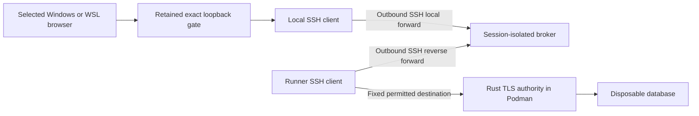

# SSH transport investigation for the hosted testbench

Status: Proposed research, 2026-11-04. Part of
[ADR-110](../architecture/ADR-110-hosted-verification-testbench.md) and
[SP-007](../spikes/SP-007-hosted-testbench.md), not a second architecture decision.
The maintainer prefers SSH over tsnet and authorized this investigation. This
selects the research direction; no broker, paid service, trust change, live
remote session or gate replacement is accepted by this document.

## Outcome, evidence and recommendation

Keep the backend on a GitHub-hosted Linux runner in Podman while actual Windows
and WSL stock browsers use the existing strict HTTPS application endpoint.
Research a restricted OpenSSH broker first. Retain tsnet build results as
historical comparison evidence; do not activate either transport automatically.

Base revision: `1ff992c572f8f9abfe0607d4838b95f45514b197`. Primary sources below
were inspected on 2026-11-04. Local version inventory found Windows OpenSSH
9.5p2 and Ubuntu OpenSSH 8.9p1. Those are observations of installed clients,
not proof of all features in current upstream manuals. No SSH connection,
broker policy canary, network partition or active-stream expiry test ran.

| Consequential premise | Status / consequence if false |
| --- | --- |
| SSH is the preferred research candidate | Established maintainer direction; architectural acceptance remains separate. |
| A reachable broker can join two outbound connections | Proposed topology using documented forwarding primitives; actual network reachability is untested. |
| SSH alone authenticates a GitHub run or source revision | Unsupported. An authenticated session-admission protocol must bind those identities. |
| Broker configuration restricts the reverse forward's ultimate destination | Contradicted by the forwarding mechanism; the runner client opens that destination. An independent runner network boundary is needed. |
| Removing custom tsnet code removes lifecycle machinery | Unsupported. Endpoint reservation, admission, deadlines, ownership and cleanup still require a coordinator. |
| Hosted compute makes the whole bench free | Unsupported. Broker hosting, transfer, administration and trust remain separate costs. |

Recommendation: proceed to a harmless, containerized SSH policy laboratory
before choosing a provider. Prefer a small dedicated broker with one admitted
session at a time initially. That is an operator simplicity proposal, not
permission to trust other local broker workloads or weaken isolation. A provider
purchase is premature until restriction and lifetime tests support this design.

## Candidate topology and boundaries

Application bytes travel from the local client through the broker's session
listener and back through the runner's connection to the authority. Connection
establishment arrows do not imply application traffic direction. The broker
must not terminate application TLS. It can observe traffic metadata and disrupt
or redirect transport; browser TLS validation must reject a substituted server.
The issuer signing key stays outside the broker and serving fixture.

The [SSH client manual](https://man.openbsd.org/ssh.1) documents local forwarding
and reverse forwarding, including that the reverse destination connection is
made by the client. A reverse forward without an explicit destination can become
a SOCKS proxy; omit that mode from the candidate. We do not assume a standard
GitHub runner has an inbound SSH endpoint. Both peers instead initiate toward
an explicitly admitted reachable broker.

The browser-facing IP/port and authority listener port retain ADR-110's exact
origin contract. Intermediate broker ports may differ. No database, engine
socket, generic proxy, remote shell or browser-control endpoint is exposed.
Windows and WSL remain separate, sequential client cases.

### Separate the two identities and enforcement points

Propose fresh runner and browser-role keys per session. Broker policy permits
only the runner's exact reverse listener and the browser role's exact connection
to that listener. Disallow other forwarding directions and auxiliary features.
The [server configuration manual](https://man.openbsd.org/sshd_config.5)
documents per-role forwarding controls, `PermitListen`, `PermitOpen` and
`MaxSessions 0`; the latter denies shell, command and subsystem sessions while
allowing forwarding. Inspect effective configuration and attempt forbidden
operations; a configuration snippet alone is insufficient.

The [authorized-key manual](https://man.openbsd.org/sshd.8) distinguishes
`permitlisten` for reverse listeners from `permitopen` for local-forward
destinations. `restrict` alone does not establish denial of command execution.
Those restrictions do not let the broker independently enforce the explicit
destination selected by the runner's reverse-forward client. Constrain that
client's network namespace to the broker SSH endpoint and one inspected
authority socket; separately deny database/engine/other-session destinations.
The precise Podman topology and resulting rule enforcement remain to be tested.

Loopback TCP on the broker is not isolated by Unix login. Use a session-isolated
network boundary or obtain explicit acceptance of a dedicated broker's trusted
local-process boundary. Never reuse a broker endpoint while an older client or
forwarding capability can still reach it. Separate accounts alone cannot prove
that another broker-local process is unable to connect.

### Retain local ownership and withhold early traffic

The preferred candidate retains a small local forwarding gate that owns the
exact browser endpoint before dispatch, then attaches only after authenticated
admission. SSH handles the encrypted remote connection, not source admission.
The gate is test-only coordination code, not a custom transport protocol.

An alternative is to establish SSH before dispatch with an independently enforced
broker admission gate. Prove that early connections cannot reach application
bytes and that a failed attempt cannot attach to another fixture. Releasing a
reserved port so `ssh -L` can bind it recreates the race; do not call it continuous
ownership. No inheritance of a prebound socket by stock SSH is established here.

## Bootstrap, deadlines and failure ownership

The authenticated admission record must bind repository, immutable tested source
and workflow revisions, run and attempt, session nonce, both role public keys,
broker host identity, exact endpoint mapping and frozen deadline. Wrong source,
role substitution, stale attempt, duplicate consumption and interrupted delivery
must fail before application attachment. SSH login is not this binding protocol.

Backend credentials stay in GitHub secrets as directed. Keep the application
issuer signing key out of GitHub and the broker. Prefer generating each SSH
private key at its owning recipient, then admitting only its public key; actual
secret delivery and enrollment still need a qualified sender/recipient mechanism.
The existing bootstrap candidate's timing and protection assumptions remain
unqualified. SSH does not make repository secrets single-run delivery by itself.

Pin the broker host identity through authenticated provisioning into a scoped
known-hosts file. Do not trust a new scan merely because it returned a key:
[ssh-keyscan](https://man.openbsd.org/ssh-keyscan.1) warns that unverified scanned
keys leave users vulnerable to interception. Keep system SSH configuration and
unrelated identities out of the experimental client configuration.

Propose three resource owners: a local supervisor closes the gate and SSH
process; a broker supervisor terminates both role connections and session
listeners; a runner watchdog terminates owned transport/backend containers.
Arm the broker's absolute cutoff before enabling forwarding. Admission fails
if any required owner or deadline acknowledgement is absent. No automatic
reconnect, deadline renewal or session reuse is proposed.

The [client configuration manual](https://man.openbsd.org/ssh_config.5) says
`ExitOnForwardFailure` covers forwarding setup, not later destination failures.
Keepalives establish responsiveness, not elapsed session lifetime. Server channel
and unused-connection timeouts likewise do not establish an absolute deadline
for continuously active traffic. Key expiry denies later authentication; it is
not evidence that existing streams closed.

Broker teardown can stop the network path independently of the runner, while
the broker is healthy. It cannot prove that a partitioned runner's backend died.
A local stop cannot prove broker cleanup. Keep stream closure, listener removal,
credential rejection, backend termination and unknown cleanup as separate results.
If a hard remote process-stop guarantee during provider failure is required,
this topology does not yet establish it; that residual needs a maintainer
decision or another enforcement platform before live admission.

## Alternatives, cost and complexity

These are research estimates, not provider selection or purchase authorization.
No throughput, regional availability, account eligibility or broker sizing was
qualified. Scores are omitted because unsupported enforcement must not be hidden
by an aggregate preference score.

| Option | Benefits | Costs and disadvantages | Complexity / disposition |
| --- | --- | --- | --- |
| Dedicated small SSH broker VM | Mature transport; no Tailscale enrollment or custom Go connector; independent network cutoff location | Internet-facing SSH needs patching, host-key lifecycle, isolation and supervision; an extra hop and paid infrastructure | Medium-high overall; preferred next laboratory target, not selected hosting |
| Existing suitable reachable SSH host | Potentially no incremental compute charge | No such host is established; sharing creates local-process/session and operational trust questions | Unknown until inspected; do not assume free availability |
| Direct SSH to the hosted runner | Removes broker operation and extra hop if truly reachable | Reachability and authenticated host-key bootstrap are unestablished; changing to paid/private networking may defeat the assumed cost model | Investigate only with concrete reachability evidence; not the default |
| tsnet userspace connector | Traversal/relay facilities and no owned public broker | Custom connector, Go closure, vendor identity/policy and revocation dependencies; runtime still unqualified | Historical alternative; activation requires a new decision |
| Hosted browsers beside backend | Avoids local transport and local browser memory for unattended cases | Does not qualify the requested Windows/WSL client paths | Complementary lane, not a substitute |

As a dated price anchor, [DigitalOcean's public basic VM prices](https://www.digitalocean.com/pricing/droplets)
list 512 MiB at USD 4/month and 1 GiB at USD 6/month. A provisional broker
compute budget is therefore USD 4-6/month on those examples, plus applicable
tax, excess transfer, optional storage/backups and operator time. Neither size
has been tested. The same page lists 16 GiB at USD 96/month: that is a larger
backend VM example, not a like-for-like broker requirement. Do not equate the
low broker price with a qualified full alternative bench.

For planning only, estimate 1-2 engineer-days for an isolated policy laboratory
and 3-7 additional days for reviewed session admission, owners and failure probes,
excluding provider/trust decisions and existing browser blockers. Confidence is
low; this is judgment, not measured delivery performance or a commitment.
OpenTofu can provision a selected VM/firewall after budget acceptance; it does
not replace session ownership, credential admission or active-stream teardown.

## Risk management and decisive experiments

Likelihood is unknown for these mechanisms. Impact and priority are independent
of confidence. Primary documentation supports the restriction semantics; the
proposed mitigations have not run. The bench operator owns experiments; the
maintainer accepts hosting, trust, architectural and residual-risk decisions.

| Risk / affected invariant | Impact / priority | Cheapest decisive observation and proposed mitigation | Residual / invalidation |
| --- | --- | --- | --- |
| S1 Runner changes reverse destination despite broker listener rule | High / P1 before live credentials | Harmless two-target canary first demonstrates the gap, then verifies an independent runner network boundary denies substitution | Trusted runner supervisor and policy integrity remain; reopen on network/image/rule changes |
| S2 Wrong session or broker-local process reaches the listener | High / P1 | Two-session and local-process negative canaries; isolate session network and refuse stale endpoint reuse | Broker administration remains trusted; reopen on tenancy/isolation changes |
| S3 Expiry only prevents login while current traffic survives | High / P1 | Keep a stream active across the deadline; independently observe local/broker closure, new-login rejection and runner cleanup | Partitioned runner death remains unproven; reopen on owner/provider/deadline changes |
| S4 Local endpoint race or forwarding before admission | High / P1 | Delay dispatch, send early bytes, collide with endpoint ownership and kill the owner; require no admitted traffic or silent rebind | The gate remains a dependency; reopen on process/socket/admission changes |
| S5 Wrong host, source, recipient or replay receives access | Critical / P1 | Harmless admission canaries with swapped keys, wrong run/source, stale attempts, duplicate delivery and interrupted enrollment | Actual protected bootstrap remains unqualified; reopen on identity/release/channel changes |
| S6 Added broker operation/cost overwhelms the expected simplification | Medium / P1 before purchase | Measure laboratory setup/cleanup effort and transfer; select provider, region, spend cap and patch owner explicitly | No guaranteed free complete bench or delivery estimate; reopen on prices/usage/provider changes |

Execute the policy laboratory in bounded Podman containers with synthetic keys
and no product trust or external enrollment. Inspect effective server policy for
both roles, then test permitted forwarding and denied shell/command/subsystem,
wildcard, extra-destination, reverse-role and cross-session paths. Version the
image and effective configuration; do not apply current manual features blindly
to the installed 8.9/9.5 clients or a future broker server.

Before local execution, admit the actual resource budget and harness cleanup.
The laboratory establishes policy mechanisms only, not internet reachability,
Windows/WSL integration, product TLS or memory savings. Paid provider and exact
trust gates remain separate. Preserve the Windows observer failures and the WSL
filesystem controls; changing transport does not invalidate or fix those results.

## Review and next checkpoint

Source-first independent framing supported SSH research under the unchanged
local-browser/TLS/lifetime outcome. Its mechanism challenge identified S1-S5,
including broker-local access and continuous endpoint ownership; those findings
are incorporated above rather than silently relaxing the requirements.
Research/review elapsed time was not instrumented; no time-saving claim is made.

Completion of this research checkpoint means a source-backed design comparison,
dated cost/effort estimates, explicit failure domains and executable experiment
oracles. It does not mean B-F passed. Next: admit and review the small SSH policy
laboratory, run harmless controls, then decide whether an actual broker is worth
provisioning. Final composition review and required documentation checks belong
to the exact published revision; architectural acceptance remains with the
maintainer.
