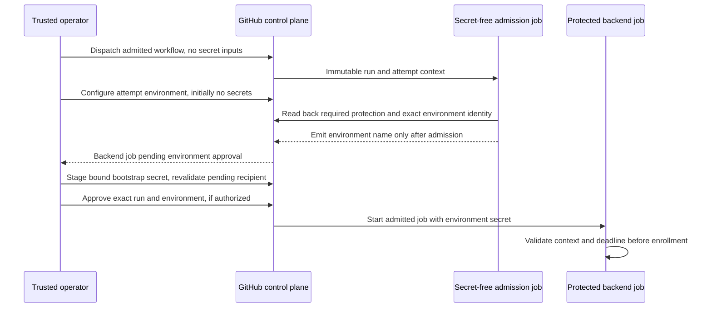

# Hosted verification research and risk management plan

Status: Proposed design support, 2026-11-03. Owner: project maintainer.
Decision: [ADR-110](../architecture/ADR-110-hosted-verification-testbench.md).
The original design milestone contained documentation only. Its probes below
remain admission or qualification criteria, not executed results. On 2026-11-04
the maintainer requested completion of the pending feasibility spikes; actual
experimental scope, permissions, observations and remaining gates are recorded
separately in [SP-007](../spikes/SP-007-hosted-testbench.md). That research does
not accept this architecture or change required gates.

On 2026-11-04 the maintainer preferred SSH over tsnet and authorized the
[SSH investigation](hosted-testbench-ssh.md). That companion updates the current
transport recommendation, costs and mechanism-specific risks. The overlay
research and C/D candidates below remain historical, unqualified alternatives;
their source/recipient, confinement and lifetime obligations still apply.
No Tailscale account access is a prerequisite to independent SSH research, and
neither transport may activate automatically. No provider has been selected.

The subsequent [brokerless SSH comparison](hosted-testbench-direct-ssh.md)
evaluates both connection directions and dynamic discovery before rented-broker
selection. Software price, public reachability and total maintenance are separate
questions. The historical broker/overlay owner maps are not requirements to buy
infrastructure or evidence that either direct path is qualified.

## Research findings and evidence limits

Research date: 2026-11-03. Repository source baseline:
`7f9301601c5de4c87f8cad7c3b1c1681d0769336`.
External sources are first-party documentation fetched during this assessment;
their current descriptions are not compatibility evidence for this project.

| Finding | Evidence and implication |
| --- | --- |
| Hosted capacity and billing | [GitHub runner reference](https://docs.github.com/en/actions/reference/runners/github-hosted-runners): standard public x64 Linux jobs offer 4 CPUs/16 GB RAM/14 GB SSD; standard public compute is free. [Limits](https://docs.github.com/en/actions/reference/limits) include a six-hour hosted-job maximum, not a session expiry guarantee. Queue latency and cold preparation remain unmeasured. |
| Platform usage | [GitHub product terms](https://docs.github.com/en/site-policy/github-terms/github-terms-for-additional-products-and-features) tie hosted use to the repository's software lifecycle and prohibit disproportionate burden. Bounded testing is the intended use here; continuous hosting is excluded. No provider-specific approval is inferred. |
| Jobs do not share a server automatically | [Service-container networking](https://docs.github.com/en/actions/tutorials/use-containerized-services/use-docker-service-containers): services belong to their job. Separate jobs require real networking and overlapping lifetimes; a completed backend job cannot serve a dependent client job. |
| A private overlay is plausible | [GitHub WireGuard guide](https://docs.github.com/en/actions/how-tos/manage-runners/github-hosted-runners/connect-to-a-private-network/connect-with-wireguard) explains reachable-endpoint requirements and Tailscale NAT traversal. [Connection types](https://tailscale.com/docs/reference/connection-types) distinguish direct and relay paths; relay timing is not a latency guarantee. |
| Process-scoped connector primitives exist | [tsnet overview](https://tailscale.com/docs/features/tsnet) and [API](https://tailscale.com/docs/reference/tsnet-server-api) provide embedded nodes and raw Dial/Listen. Userspace operation avoids a required system-wide interface. The project's exact Windows/WSL binaries, policy, forwarding and dependency closure are unqualified. |
| Enrollment and expiry differ | [Auth keys](https://tailscale.com/docs/features/access-control/auth-keys): enrollment-key expiry does not revoke an enrolled node; tagged node-key expiry is disabled by default. [Ephemeral nodes](https://tailscale.com/docs/features/ephemeral-nodes) normally disappear 30–60 minutes after inactivity. Neither establishes a 30-minute active-session cutoff. |
| Rules must exclude broad defaults | [ACL examples](https://tailscale.com/docs/reference/examples/acls) and [grants](https://tailscale.com/docs/reference/syntax/grants): review the entire effective policy, including defaults and additive grants. Identity/tag ownership is as important as the narrow port rule. |
| Stock browser choice affects tooling | [Playwright browsers](https://playwright.dev/docs/browsers) says Firefox requires patches; branded Chrome can be selected explicitly. [Selenium Firefox](https://www.selenium.dev/documentation/webdriver/browsers/firefox/) and [Chrome](https://www.selenium.dev/documentation/webdriver/browsers/chrome/) document browser selection and headless arguments. Prefer one WebDriver-based matrix for actual stock executables; browser/profile trust remains a separate proof. |
| Implicit downloads undermine reproducibility | [Selenium Manager](https://www.selenium.dev/documentation/selenium_manager/) automates driver/browser management. Explicit preparation and fixed binaries are proposed instead of discovery/download during a test. [WebDriver options](https://www.selenium.dev/documentation/webdriver/drivers/options/) include certificate-error bypass; the harness must explicitly disable it. |
| WSL is a distinct client environment | [Microsoft networking](https://learn.microsoft.com/en-us/windows/wsl/networking) distinguishes NAT and mirrored behavior. [WSLg](https://learn.microsoft.com/en-us/windows/wsl/tutorials/gui-apps) supports Linux GUI applications under WSL 2, not a full independent desktop. Headless Linux execution is still Linux even without a visible WSLg window. |
| OpenTofu has a narrower role | [Overview](https://opentofu.org/docs/intro/) covers provider-managed infrastructure; [sensitive state](https://opentofu.org/docs/language/state/sensitive-data/) and [encryption](https://opentofu.org/docs/language/state/encryption/) require deliberate state/key controls. It is useful if a broker or VM is adopted, not necessary for the initial hosted-job lifecycle. |
| Certificate identity and port agreement differ | [RFC 9525 section 6.4](https://www.rfc-editor.org/rfc/rfc9525.html#section-6.4) matches an IP SAN against IP bytes. The port agreement comes from `startup.rs` and exact HTTP Host/Origin admission; do not mint an IP SAN containing a port. |
| Browser profile and certificate trust can have different lifetimes | [Chromium Linux certificate management](https://chromium.googlesource.com/chromium/src/+/main/docs/linux/cert_management.md) describes a shared NSS database. Actual trust-store isolation and cleanup need browser/OS-specific evidence. |
| Dispatch and secrets are different interfaces | [GitHub dispatch inputs](https://docs.github.com/en/actions/reference/workflows-and-actions/events-that-trigger-workflows#workflow_dispatch) and [secret scopes](https://docs.github.com/en/actions/how-tos/write-workflows/choose-what-workflows-do/use-secrets) do not supply a documented automatic confidential single-run payload. Select and qualify the session-bound delivery mechanism before secret use. |

### Cost and capacity assumptions

[Tailscale pricing](https://tailscale.com/pricing), as fetched on the research
date, lists Personal at $0 with 1,000 ephemeral-resource minutes/month, Standard
at $8/user/month with 1,000, and Premium at $18/user/month with 10,000. Extra
ephemeral capacity requires a sales inquiry. Eligibility, billing classification
of each connector and applicable terms must be confirmed before adoption.

Illustration only: 20 sessions x 30 minutes x one ephemeral runner identity =
600 runner-identity minutes, excluding preparation, delayed cleanup and other
identities. Charging three ephemeral identities for those intervals gives 1,800
minutes. Neither calculation is a bill prediction. Do not keep sessions alive
to exploit a different accounting category. No paid purchase is authorized.

Keep one Cargo job and serial heavy service phases. Measure total job RAM,
container peaks, available disk before/after preparation, image/cache growth,
preparation/test/cleanup time, client RAM and direct/relay behavior. Compare
the same client scenario with and without backend offload; use no invented
percentage savings. Local WSL/browser memory and the unchanged staged gate
remain material costs. The current 2 GiB runner limit excludes service/engine
overhead; no service-wide total bound follows from it.

## Component and contract map

| Boundary | Required behavior and proposed code location |
| --- | --- |
| Workflow admission | New separate session workflow; trusted workflow and reviewed immutable source; read-only repository token by default; no secrets in ordinary PR jobs. The existing `ci.yml` is not repurposed into a waiting server. |
| Hosted fixture | New session lifecycle entry point adjacent to container verification; reuse protected startup/fixture primitives after review, not diagnostic production endpoints or imported experimental application code. Backend/database remain contained and isolated. |
| Local connector | Test-only helper retains one bound loopback endpoint across dispatch and attachment, then forwards only after admission to one fixed peer destination. No generic proxy/control socket; independent build/dependency review. No production linking to tsnet is proposed. |
| Runner connector | Raw byte-forwarding endpoint in its own restricted container/network boundary; fixed authority container address/port; no engine socket, host namespace, privileged mode or database forwarding. Direct SSH uses runner-server destination enforcement; runner-initiated reverse SSH needs independent client-side destination confinement. |
| Browser runner | Python WebDriver suite with pre-admitted browser/driver, loopback driver endpoint, fresh protected profile, separately qualified trust store, one worker and no automatic mutation retries. Windows and WSL emit separate results. |
| Client storage | Separately specify profile, temporary state, diagnostic and trust locations/lifetimes. Admit actual OS ownership/permissions, locks, socket-path limits and cleanup; Windows ACL protection alone does not establish POSIX semantics. New storage boundaries require approval. |
| Secret delivery | Select authenticated sender/recipient and confidential transit/storage bound to the session and run attempt; reject replay/cross-session delivery and reconcile interruption/cleanup. No secret dispatch input or public artifact; issuer signing key stays outside the transfer. |
| Evidence collector | Bind exact source/workflow/run attempt and case manifest; distinguish passed/failed/incomplete and cleanup outcome; public allowlist of reviewed fields. Raw screenshots, network traces, profiles and driver logs stay protected. |
| Future gate replacement | Separate exact-staged-tree design and policy review. No source upload, bypass flag, new remote hook or removed check in this PR. |

Expected application changes: none identified for the proposed browser path.
`startup.rs` and `http_auth.rs` retain exact origin/TLS admission; `page.js`
retains relative requests. A demonstrated incompatibility reopens ADR-110 rather
than justifying silent relaxation. The Windows CLI's DPAPI credentials do not
become a Linux credential-store design.

## Confidential-bootstrap candidate for spike C

This is a concrete **proposed protocol**, not an existing channel or permission
to create environments, release secrets or approve deployments. Read-only
inspection found no configured environment to reuse. Retain backend credentials
in GitHub secrets; keep the issuer signing key outside the serving fixture.

Recommend one protected environment per run **and attempt**, with one explicitly
admitted recipient job. [Environment secrets](https://docs.github.com/en/actions/reference/security/secrets)
are read at job start, unlike repository secrets read at queue time. A single
bounded bootstrap document keeps credentials and their context in one version;
its encoded size must fit the provider's 48 KB limit. GitHub cautions against
structured secrets for automatic log redaction: the candidate therefore requires
no secret-bearing public output, not confidence in masking parsed fields.

| Binding | Trusted verifier / required comparison |
| --- | --- |
| Repository and workflow | Operator verifies provider repository/workflow identity, admitted workflow commit/blob and pinned action/reusable-workflow closure. A protected branch flag is insufficient. |
| Tested source | Operator admits immutable source SHA/tree separately; neither a branch name nor maintainer dispatch accepts arbitrary test code. |
| Recipient | Operator checks run ID, attempt, sole job/deployment and environment numeric ID. The job validates the same tuple before enrollment or serving. |
| Credential purpose | Bundle fixes recipient role, endpoint mapping, expiry and expected local peer; the resolved remote peer is admitted before forwarding. No issuer or administrative credential enters the fixture bundle. |
| Single use | Protected operator ledger records the attempt, environment, payload version and consumption/cleanup state. No environment or bundle reuse after interruption. |

Proposed ordering:

1. A trusted local owner first reserves the browser endpoint and records the
   overall deadline. Dispatch uses a provider-admitted workflow entry point;
   [registration/default-branch requirements](https://docs.github.com/en/actions/reference/workflows-and-actions/events-that-trigger-workflows#workflow_dispatch)
   still need verification. Claim one unambiguously correlated provider run;
   never guess the latest run on a branch. This proposal permits no merge to
   obtain an entry point.
2. The admission job has only necessary metadata-read permission, no bootstrap
   environment and no tested code. It cannot provision protections or approve
   itself; administrative authority stays with the trusted operator.
   Derive a canonical lower-case environment name from run ID and attempt, never
   an arbitrary dispatch input. The backend job's environment name depends on
   the successful admission job's output. GitHub [allows a `needs` expression](https://docs.github.com/en/actions/reference/workflows-and-actions/workflow-syntax#jobsjob_idenvironment)
   here. Withhold that output until the exact configured environment and approved
   protections are read back; an absent/unobservable rule fails admission.
3. The operator configures required reviewers, the exact permitted ref type/name
   and the accepted administrator-bypass policy before staging any credential.
   [Auto-created environments](https://docs.github.com/en/actions/how-tos/deploy/configure-and-manage-deployments/manage-environments)
   can lack protection. The delayed-reference ordering must be demonstrated with
   a harmless canary before real-secret use; YAML dependency structure alone is
   not executed proof of provider protection-evaluation timing.
4. Only one backend job may reference that environment. Reject matrices, multiple
   consumers or an unknown graph. Inspect the pending deployment and all binding
   fields again, stage one complete secret, then release only the intended run
   and environment. Freeze means the operator ledger forbids further mutation
   and other mutating authority is excluded or explicitly admitted; it is not a
   GitHub environment-immutability guarantee. A sole maintainer's
   self-review prevention can prevent their own dispatch from proceeding;
   changing that policy or authorizing an automated release actor is a maintainer
   decision. An agent must not present its release as human approval.
5. The [review endpoint](https://docs.github.com/en/rest/actions/workflow-runs#review-pending-deployments-for-a-workflow-run)
   takes a run and environment IDs, not an attempt. The initial candidate accepts
   only provider attempt 1. Reject full, partial and job-only reruns before the
   protected job is dispatched: its predicate checks the current attempt and the
   upstream admission attempt, so cached `needs` outputs cannot authorize release.
   A retry needs a fresh dispatch/run ID, environment, bundle and node identities.
   This also prevents a delayed run-scoped cancellation from targeting a legitimate
   later attempt under the same run ID. Qualify predicate/protection ordering,
   stale approval, duplicate consumers and canceled pending jobs with canaries;
   a name convention or an inside-job check is not pre-delivery proof.
6. Only a trusted bootstrap step handles the document as data, never interpolated
   shell code or command-line arguments. It checks context/expiry, writes only
   approved protected fixture files, and drops unrelated credentials before
   starting Podman-contained workloads. The fixture receives its leaf key and
   synthetic password; enrollment material reaches only its connector. Provider
   secret storage does not hide plaintext from an admitted runner process.
7. Public progress contains only allowlisted run/source/attempt, admitted deadline
   times and closed status fields. It carries no peer identity, credential digest
   or raw diagnostic.
   Before attachment the operator separately authenticates the actual overlay
   peer and strict-TLS leaf possession. A job status is not that proof. Missing
   or ambiguous acknowledgement stops the attempt; never resend or silently
   resume it. Start a fresh attempt only after reconciliation.

| Interrupted state | Required disposition / remaining exposure |
| --- | --- |
| Reserved, no delivery | Stop owned local endpoint and admission job; retain the first failure. |
| Environment configured or secret staged, no receipt | Reject pending release, cancel the run, reconcile secret/environment and unused enrollment key. Deleting a secret cannot recall a value already read by a job. |
| Enrolled, not attached | Stop owned connector/backend, revoke enrollment capability and remove the exact recorded nodes; discover ambiguous enrollment through the protected ledger/provider, not hostname-substring deletion. |
| Cleanup interrupted or observation unavailable | Record unknown cleanup, deny attachment/reuse and invoke the separately protected revoker. Neither a successful API request nor a later fresh attempt clears uncertainty. |

The candidate depends on immutable source admission, observable protection and
single-recipient ordering. It is not qualified if the provider cannot establish
those properties. A future canary experiment needs an approved protection and
workflow fixture. No attempt environment, protected-channel credential transfer
or deployment release has been executed for this candidate. Earlier credential
preparation is separate from channel qualification.

## Expiry-enforcement candidate for spike D

Recommend three distinct owners: a trusted local supervisor, a runner watchdog
outside the tested containers, and a separately protected revocation workflow on
another runner. This is an unqualified candidate, not an independent hard-expiry
guarantee. The revoker shares GitHub's provider failure domain with the backend;
neither two jobs nor two timers remove that dependency.

| Owner / protected authority | Resources it can terminate | Failure domain and limitation |
| --- | --- | --- |
| Local supervisor, outside the connector/test scripts | Retained local listener, forwarding streams and owned helper/client processes through the admitted OS owner | Survives backend-runner failure; cannot revoke remote nodes or guarantee remote deletion. Local host loss/compromise can defeat it. |
| Trusted runner watchdog, outside fixture/connector containers | Owned Podman containers, remote listener/connector and their processes | Survives a contained fixture failure; shares runner host, kernel and provider. It respects tsnet startup/Close ordering and uses process ownership for forced termination. |
| Separate trusted revoker workflow, no tested code | Exact recorded enrolled nodes/unused enrollment keys through Tailscale administration; cancellation of the bound backend run through GitHub | Survives backend-runner or local-supervisor failure while its own runner and APIs work. It cannot independently kill a partitioned backend host; its requests require separate effect observations. |

Keep administrative credentials in a separately protected GitHub secret scope,
never the backend bundle. Admit the revoker's own workflow/run/attempt separately
from the backend run/attempt it may stop. Provider-supported least privilege and
exact device ownership remain account-specific qualification, not inferred from
possession of an API token. This research has provisioned no administrative
revocation credential or revoker workflow.

Proposed deadline contract:

1. Before dispatch, the local owner durably records a 45-minute overall deadline
   and starts a monotonic timer. The runner watchdog independently enforces that
   admitted overall limit while preparing the fixture. Queue/preparation time
   consumes the allowance; a late job cannot grant itself a fresh period.
2. After actual peers are identified, but before attachment, the operator fixes
   one session deadline: no later than the overall deadline or 30 minutes after
   this arming decision. Start the separate revoker with those exact private peer
   identities and the frozen deadline using candidate C's attempt-bound delivery.
   Starting it before node identities exist would not establish exact revocation.
3. The trusted revoker emits an authenticated-provider control record containing
   only admitted public run/source/attempt, target run/attempt, deadline and status
   fields. Candidate carrier: an [immutable v4 artifact](https://docs.github.com/en/actions/tutorials/store-and-share-data)
   from the admitted revoker,
   with no peer identifier or credential. The runner watchdog and local owner
   verify artifact identity/digest, provider run metadata, accepted producer
   workflow/source and target before installing that deadline. The
   [documented artifact metadata](https://docs.github.com/en/rest/actions/artifacts)
   example identifies a run but supplies no attempt field; do not assume a native
   attempt attestation. Qualify the trusted publisher's provider-derived attempt
   binding and rerun behavior. Embedded fields, filenames, ambiguous producers or
   successful dispatch alone cannot establish an authenticated arming receipt.
   Verify the digest and reject a mismatch explicitly: the documented download
   action behavior is a warning, which cannot satisfy this admission contract.
4. Attachment requires the revoker's observed armed receipt and matching watchdog
   and local deadline installation. Missing, conflicting or late acknowledgements
   fail admission. Readiness occurs only after those controls; arming latency
   therefore reduces the usable session allowance. This is at most 30 minutes,
   not a promise of 30 usable minutes after readiness, and changes the earlier
   budget proposal explicitly for maintainer review. Never extend the deadline
   to recover preparation or arming time.
5. UTC fields bind the actors' common deadline; monotonic timers enforce each
   local limit. A conservative clock-skew bound and pre-deadline shutdown budget
   must be selected and qualified before use. Map UTC to a monotonic cutoff once,
   subtract those allowances, and begin stopping early enough to finish by the
   admitted deadline. Wall-clock jumps, restart or duplicate records cannot reset
   a timer. If clock/boot continuity or the skew bound is unknown, refuse resume
   and reconcile the old attempt. No numerical skew or shutdown bound is claimed.
6. At cutoff, deny new attachment, close existing local streams and stop owned
   remote containers/listeners. The revoker requests backend cancellation and
   exact node removal, and revokes unused enrollment capability. An enrollment
   key's expiry, a certificate's expiry and deleting an environment are not
   substitutes for terminating current access or already delivered credentials.

[GitHub cancellation](https://docs.github.com/en/actions/reference/workflows-and-actions/workflow-cancellation)
uses condition evaluation and staged process termination; its documented
cancellation period can reach five minutes. The [force-cancel API](https://docs.github.com/en/rest/actions/workflow-runs#force-cancel-a-workflow-run)
is an escalation after normal cancellation does not respond, not a proof of
deadline-time process death. [Tailscale removal documentation](https://tailscale.com/docs/features/access-control/device-management/how-to/remove)
states that removal immediately disconnects a device and warns that it can rejoin
without administrator reauthorization when device approval is disabled. Treat
that as vendor-described normal behavior; actual active-stream/partition behavior
and prevention of reenrollment still need observed controls. Remove the exact
recorded devices, never whatever currently matches a broad name or tag substring.

| Failure case | Required observation / residual exposure |
| --- | --- |
| Bootstrap interrupted before revoker arming | No local forwarding. Runner watchdog and platform timeout bound preparation only under their stated healthy-host assumptions; independent remote cleanup remains unproven. |
| Local owner killed or host lost | Separate revoker and runner watchdog must act without a local callback; observe remote shutdown and node removal. Local-host loss itself is not their proof. |
| Backend runner lost or nonresponsive | Local owner closes retained streams. Revoker acts on exact identities; missing remote process observation remains unknown cleanup. |
| GitHub cancellation accepted or delayed | Record request separately from active-stream closure, process/container termination and final run state. Escalation does not clear the first failure. |
| Tailscale administration unavailable | Local and runner owners still enforce their cutoffs while healthy; enrolled-node revocation remains unknown. Do not silently extend the session. |
| GitHub/control-plane outage or compromised owner | Shared-domain controls may fail together. A hard remote stop is not established; admission needs explicit residual-risk disposition or a different enforcement platform. |
| Restart, stale receipt or lost ledger | Reject old-attempt resumption and all provider reruns; reconcile exact resources without granting a new deadline. A legitimate retry uses a new run and fresh nodes, so late run-scoped cancellation/node deletion cannot target it. |

The actual probe must keep an independently witnessed stream alive immediately
before expiry, then observe stream closure, owned-process/container termination
and enrolled access separately. Natural HTTP idle timeout or API-request success
cannot satisfy those oracles. The five-second product limits remain unchanged.
Clock mapping, protected revoker delivery/arming, operating-system ownership and
outage behavior are unexecuted. This candidate cannot yet satisfy D's live gate.

## Risk management plan

Likelihood is unknown unless an observation is stated. Impact and urgency are
separate: Critical/High describes consequence; P1 means resolve before the named
dependent work, P2 before cutover/qualification. Owners below are proposed roles;
the maintainer assigns them and retains acceptance authority. Risk scores or
reviewer agreement cannot accept architectural/security tradeoffs.

| Risk and invariant | Evidence, confidence and likelihood | Impact / urgency | Control and cheapest future check / cost | Residual owner, acceptance and invalidation |
| --- | --- | --- | --- | --- |
| R1 Untrusted revision receives network or fixture credentials | Public PR scripts execute arbitrary code; [GitHub secure-use guidance](https://docs.github.com/en/actions/reference/security/secure-use). High source confidence; unknown likelihood. | Critical / P1 before enrollment | Admit workflow and source SHAs separately; narrow credentials and immutable dependencies. Negative admission test for fork, substituted SHA and changed workflow; low compute, no local network needed. | Workflow owner; maintainer accepts execution boundary. Reopen on action/workflow/token-scope changes. |
| R2 Overlay provides new access to local or unrelated services | Userspace is not an access policy. Source-derived threat; unknown likelihood. | Critical / P1 before local connection | Dedicated identities, effective deny-by-default policy, no reverse listener/proxy, fixed destination. Retain the bound local endpoint across dispatch. Check port collision/lost ownership, remote-originated local connection, DB/engine sockets and other-session peers; bounded isolated network cost. | Transport owner; maintainer accepts policy/vendor boundary. Reopen on policy/tag/connector/network change. |
| R3 TLS/origin protection is bypassed or trust escapes its approved scope | Exact loopback is enforced today; WebDriver can ignore certificate errors; Chromium Linux can use shared certificate storage. High confidence; unknown likelihood of misconfiguration. | Critical / P1 before browser qualification | Keep Rust TLS and same origin; explicit false bypass capability. Prove intended positive and wrong-CA/IP/issuer/expired-cert negative cases in each browser, actual trust-store scope, no unintended ordinary-browser trust, and exact removal after interruption. Bounded temporary trust work only after exact approval. | Security/harness owner; maintainer controls trust approval. Browser/profile/trust changes invalidate affected evidence. |
| R4 Access or active streams outlive the session owner | Auth-key expiry and ephemeral GC do not impose active-session expiry; co-located timers share runner failure. High confidence; unknown incident likelihood. | High / P1 before live session | Qualify the [three-owner candidate](#expiry-enforcement-candidate-for-spike-d), including clock/stop bounds and protected revoker arming. Separately observe stream closure, owned-process termination and enrolled access. Test controller death, runner loss, active-stream expiry, control-plane outage and local restart; medium harness work. Withhold live admission until bounded residual exposure is explicitly accepted. | Transport owner; maintainer accepts outage/expiry residual. Reopen on supervisor, credential or provider semantics. |
| R5 Descriptor/result is forged, replayed or secret delivery crosses sessions | GitHub authentication does not privatize public artifacts or establish a confidential per-run channel. High confidence; unknown likelihood. | High / P1 before secret use or attachment/publication | Qualify the [attempt-bound delivery candidate](#confidential-bootstrap-candidate-for-spike-c); authenticate run/attempt/workflow/source and peer, reject reruns/replay/wrong recipients and reconcile partial cleanup. No secret descriptor fields or public bootstrap output. Use harmless canaries before real credentials; provider masking and artifact warnings are insufficient. | Evidence/secret-delivery owners; maintainer owns channel acceptance and publication. Channel, schema, collector or storage changes invalidate controls. |
| R6 Passing subset or error classification hides a product/harness/cleanup failure | Current reporting has distinct ownership and failure obligations; expected HTTP rejection is case-specific evidence. High source confidence; unknown likelihood. | High / P1 before gate use | Exact case manifest, separate cause/stage and qualification, durable first unexpected failure and independent DB/read-back oracle. Confirm expected rejection can pass its oracle; product failure, missing report, TLS/transport/environment interruption and cleanup failure cannot produce a campaign pass. Low focused cost before browser campaign. | Harness owner; maintainer accepts evidence. Case/oracle/result-contract changes reopen review. |
| R7 Capacity or WAN delay produces false eligibility claims | Current CI passes do not bound cold disk, relay latency or local RAM. High confidence in gap; workload probability unknown. | Medium / P2 before qualification | Measure both client environments, cold/warm hosted phases and relay path. Preserve deadlines; classify environment failure and retain attempt, not blind retries. Medium compute/time after resource approval. | Verification owner; maintainer selects paid capacity if warranted. Runner/image/region/browser changes invalidate measurements. |
| R8 Browser label overstates platform coverage | Patched Firefox, Chromium and Windows-launched-from-WSL differ from intended binaries. High source confidence; unknown occurrence. | Medium / P2 before qualification | Record actual executable identity, version, OS, profile and capability; prove JS/cookie/CSRF flow. Fresh fixtures for password/revocation cases. Small sequential matrix. | Browser owner; maintainer accepts support scope. Binary/profile/OS changes require affected checks. |
| R9 Local gate is removed before equivalent hosted proof | Current hook checks immutable staged index plus unchanged HEAD. High confidence; unknown migration likelihood. | High / P1 before cutover | Keep gate; separately test index/HEAD mutation, wrong tree/base, absent report and uncommitted-source disclosure controls. Cutover amendment and rollback rehearsals required. | Delivery owner; maintainer accepts gate policy. Hook/source-transfer/required-check changes reopen admission. |
| R10 Connector quota or vendor failure blocks testing | Current pricing has finite ephemeral minutes; service dependency is new. High source confidence; unknown usage/outage likelihood. | Medium / P1 before vendor enrollment | Confirm plan and identity accounting; explicit budget and quota monitor. Recheck pricing and measure session lifespan. Low research cost; no purchase now. | Bench operator; maintainer accepts vendor/budget. Pricing, usage or account changes reopen decision. |
| R11 Client temporary storage is incompatible or escapes its admitted privacy boundary | [SP-007-R08](../spikes/SP-007-hosted-testbench.md#sp-007-r08-wsl-stock-chrome-preparation-and-storage-admission-2026-11-04) observed mode `0777` after requesting `0700` and a failed 189-byte Unix socket bind. High confidence for that filesystem; occurrence elsewhere is unknown. | High / P1 before affected client launch | Separate profile/temp/log/trust locations and lifetimes. Obtain approval before adding a storage boundary; inspect actual owner/mode, bounded socket/lock behavior and owned cleanup. One cheap pure-OS fixture before browser execution; no silent temporary-directory fallback or relaxed security checks. | Harness owner; maintainer accepts storage/privacy scope. Filesystem, mount, path or browser changes invalidate admission. |

Review risks at topology/dependency changes, before live admission, before gate
cutover and at delivery closeout. Do not repeat the entire register per commit.
Stop affected work on a failed isolation/TLS/expiry control; preserve failure
and owned-cleanup evidence, repair the harness, then rerun only affected cases
and necessary controls. Existing required gates are not waived by this rule.

## Qualification criteria and staged delivery

| Checkpoint | Required evidence before continuing | Remaining authority |
| --- | --- | --- |
| A Design acceptance | Maintainer dispositions of ADR-110's four decisions; topology and lifecycle invariants may be accepted with mechanism/plan admission gates still outstanding; no claim of runtime proof | No implicit trust, account creation, purchase or test execution permission |
| B Harness preparation | Exact expiry/control-path mechanism and vendor plan selected; dependency/connector review; bounded positive/negative lifecycle tests; actual Windows/WSL and Podman compatibility admission; immutable source/descriptor verification | Exact resources/network/local-helper permissions before live probes |
| C Automated integration | Sequential stock browser cases with strict TLS; sign-in, pending save without creation, reload/discovery, explicit execution/cancel, reconciliation and fresh authorized read; independent final-state oracle | Product behavior and five-second limits unchanged |
| D Final local qualification | Batched Windows/WSL headless cases plus justified headed cases; explicit certificate approval/cleanup; failure, disconnect, expiry and revoked-session controls; measured RAM and timing | User attention/trust scheduled only after harness repair/review |
| E Gate cutover | Separate accepted staged-source contract; proof missing/wrong/stale evidence fails; existing coverage preserved; rollback and publication controls | Current local/CI policy remains until explicit cutover acceptance |

Isolation controls include allowed application port and denied database/engine/
unrelated local ports, other sessions, reverse initiation and a wrong authenticated
session/transport mapping.
Lifecycle controls include duplicate attachment, timeout before readiness,
stale run attempt, connection loss before/after commit, controller kill without
finalization and expiry during an active stream. A cancelled or incomplete
campaign cannot yield a passing terminal result. A retry preserves the original
failure and receives a new attempt/fixture identity.

Admission controls must additionally cover retained-port ownership through a
delayed dispatch and safe failure if that ownership is lost; each selected
Windows/WSL path uses its actual networking configuration. Browser trust controls
must identify all affected stores and show that removing the test profile alone
does not conceal residual trust elsewhere. Secret-delivery controls must reject
wrong run/attempt/recipient and replay, preserve issuer-key separation, and
reconcile partial delivery without exposing keys in public output. Result-model
controls must retain an unexpected failure through later transport loss, cleanup
and successful fresh attempts, while allowing a correctly witnessed negative
application case to pass. These refine existing R2–R6 admission obligations;
they do not report an executed defect or authorize a live campaign.

Keep commits focused within coherent capabilities: session ownership/transport,
browser journeys, then separately accepted gate migration. Do not split tightly
coupled producer/consumer changes just to satisfy a line count. Queue existing CI
at the first coherent checkpoint; no generic extra qualification campaign.

## Original design milestone review and delivery record

Authorized scope: research and a Proposed design/risk PR. Completion criteria:
source-backed alternatives and recommendation; Windows/WSL/code-change map;
concrete risks, owners and admission controls; external-cost/compatibility gaps;
independent relevance/final-head review; required documentation checks and PR.
No implementation, service/container/browser run, enrollment or trust operation
is part of this delivery. Component runtime reviews and live harness execution
are inapplicable here; their future admission obligations are defined above.

Request-first independent framing inspected the baseline contracts before the
candidate. It identified the remote-topology acceptance gap. Candidate review
required separating public descriptor authentication from confidentiality,
naming connector APIs instead of assuming userspace isolation, and exposing
expiry/revocation as an admission gate. These dispositions are incorporated in
ADR-110 and R2–R5. Final committed-head review and actual check results belong in
the PR record; neither changes Proposed status.

Proportional closeout: the research/design milestone delivers a decision aid,
not memory savings or a working bench. The stock-Firefox distinction changed
the automation recommendation; provider lifecycle and pricing prevented claims
of automatic expiry or zero total cost. Retain source-first challenge at the
implementation boundary. No process effectiveness or time savings is established.
Preparation, compilation, runtime tests and cleanup phases were not executed;
research/authoring/review overlap and fine-grained durations are unmeasured.
At the implementation closeout, compare actual resources and failure discovery
against these premises without rewriting retained failed evidence.

The bounded documentation follow-up clarifies endpoint ownership, IP identity
versus application port agreement, actual trust-store scope, confidential secret
delivery and cause-versus-qualification reporting. It retains the existing
expiry, quota, pinned-tool, WAN and staged-gate controls. These are source-backed
admission refinements, not proof of a working bench, isolated browser trust,
independent revocation or measured memory relief. Exact-head review and actual
checks for the follow-up belong in PR #93; architectural acceptance remains
separate and the maintainer has requested no PR status change or merge.
