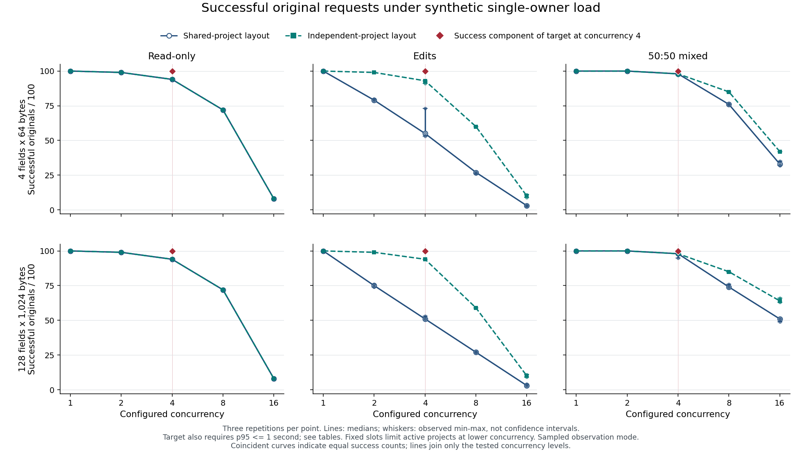

# Native authority capacity observations - 2026-11-09

This is a complete **180-cell synthetic measurement baseline**. The maintainer selected retaining the current design for constrained pre-MVP use, with the measured limitations accepted for now and a high-priority redesign follow-up. Final delivery qualification remains separate from this capacity disposition.

## Retained-design disposition and operating limitations

The current design is retained without a coordination change. This decision accepts the observed shortfall; it does not make the original four-request target pass or establish general MVP readiness. A product that promises reliable concurrent use needs a better-supported capacity envelope before making that promise.

- All serial trials succeeded under the tested conditions. Serial application use is the conservative demonstrated envelope, not a guarantee for arbitrary datasets, hardware, background activity or production traffic.
- At four concurrent application requests, every repetition missed 100/100 successes. Between 2 and 49 originals per repetition failed through the recorded capacity/retry outcomes. Their p95 latency still met the one-second component.
- Mixed trials at concurrency two succeeded, but read-only and edit-only trials did not establish general support at that concurrency. Four sessions do not imply four concurrent requests are reliably supported.
- Busy and exhausted-retry outcomes remain visible failures. This report does not authorize blind retries, replacement operation identities or changes to deadline, authentication, cancellation or fencing semantics. Existing operation identity/reconciliation contracts continue to apply.
- The profiles are synthetic, the default product seed was only an untimed validity control, and each cell contains 100 measured originals with three repetitions per configuration. Browser behavior, sustained production traffic, multi-owner use and multiple active authorities are outside the evidence.

The [high-priority redesign follow-up #100](https://github.com/MrQuality/kehila/issues/100) will evaluate bounded coordination alternatives, including an optional event-driven architecture. No redesign option is selected or qualified by this disposition. See [the delivery PR](https://github.com/MrQuality/kehila/pull/99) for final checks and review status.

## Observed outcome

Every cell passed its independent durable-state and identity witness, complete evidence export and owned reset/cleanup. The 180 cells contain 18,000 measured originals, 1,800 warmup originals and 180 separate post-load serial edits. There were 13,329 measured successes, 3,745 Busy responses and 926 exhausted retry outcomes. Those totals combine different workloads and loads; they are not a single throughput or availability SLA. No measured transport-failure, request-deadline, unavailable or uncertain outcome was observed, and no phase required identity reconciliation.

All 36 concurrency-four repetitions reached observed overlap four. Every one missed the requirement for 100 successful originals: success counts ranged from 51 to 98 out of 100. Their all-original p95 values ranged from 23.241 to 431.212 ms, below the one-second latency component. Low latency does not compensate for rejected or exhausted originals, and accepting more work could change those latency populations.

All serial repetitions completed 100/100 measured originals. Mixed workloads at concurrency two also completed 100/100; read-only and edit-only results at the same concurrency did not establish a general concurrency-two success envelope. Higher-concurrency results describe overload behavior and introduce no new SLA.

The figure shows the median and observed minimum/maximum of three repetitions. Whiskers are not confidence intervals. Coincident curves indicate equal success counts. The red marker shows only the success component of the accepted target at concurrency four; the latency component remains in the tables. Larger configurations and different mixes can change accepted-work populations, so a higher success count or lower all-original p95 in an overloaded cell is not an isolated record-size benefit or a causal speedup.

## Scope and method

Load enters the application HTTP API over verified TLS. Four concurrent requests means four client calls in flight, not four database connections. Four separately issued sessions belong to one owner and use one active authority. The client and application share runner resources; this is not browser/UI or independent database throughput qualification.

The compact profile has four 64-byte text values per item; the large profile has 128 1,024-byte values. Both are test-only configurations initialized through the existing fenced storage path. The current project-creation UI/API seeds two text fields per type. The unchanged default seed passed a separate untimed input/observer validity control; it has no timed capacity result in this matrix. No product configuration feature or schema change is established.

Each cell starts from a fresh owned database and sixteen seeded items. The shared layout uses one project; the independent layout seeds four. Fixed item slots mean only one/two projects are active at concurrency one/two and all four at concurrency four or higher. Original ordinals rotate through the four sessions. Each phase settles earlier work and starts fresh closed-loop workers, so the measured phase includes its initial concurrency burst; warmup does not establish a continuously running steady state.

Every request uses a new verified TLS connection. The shared client configuration retains its default resumption policy; the actual resumption fraction was not measured. Client latency includes connection establishment, response-driver cleanup and result validation. Throughput uses the complete phase window, including request preparation and evidence encoding. Setup, authentication pacing, reconciliation and the post-load progress edit are outside the measured-original population. No failed original is replaced by recovery.

Queue/mutex/service and worker CPU distributions have different populations and can overlap. Completed/incomplete wall spans remain separate. OS thread CPU is measured inside actual synchronous worker execution, distinct from elapsed wall time. Five-millisecond backend observations report sampled waits/blockers and query exposure, not exact wait durations or automatic actor/project attribution. Separate known actor/project blocker controls on this source observed the intended transaction edge and query, then both original edits succeeded after release. That qualifies known-cause detection/release, not representative lock-wait duration or negligible observer cost.

The input/observer control and an intentionally altered expected final field check provide method controls. The ordinary cells' independent SQL compares exact canonical requests, accepted results/history, final fields, rejected-operation absence, project chains and released authority; unexpected payload retirement is rejected. The full-source correctness/failure campaign and final review gates are separate from this performance evidence.

## Observer comparisons

All 36 selected observations completed: four workload groups, three repetitions and off/stages/sampled modes with order rotated by repetition. Twelve sampled observations count once within the 180-cell matrix; 24 off/stages controls are additional observations. All modes use the same test binary and retain fixed test-instrumentation costs, so off is not a zero-instrument production baseline.

| Shared-project workload | Successful originals, off (reps 1-3) | Stages | Sampled | Sampled/off all-original p95 ratios |
| --- | --- | --- | --- | --- |
| compact / mixed / c4 | 98, 98, 98 | 98, 98, 98 | 98, 98, 98 | 1.043, 1.051, 1.079 |
| compact / read / c1 | 100, 100, 100 | 100, 100, 100 | 100, 100, 100 | 0.882, 0.932, 1.007 |
| large / edit / c1 | 100, 100, 100 | 100, 100, 100 | 100, 100, 100 | 1.118, 0.944, 1.087 |
| large / mixed / c4 | 98, 93, 98 | 96, 98, 98 | 98, 98, 95 | 0.769, 0.940, 0.944 |

These ratios are descriptive repetition comparisons, not a universal overhead correction. The serial all-success groups are the cleanest matched-work controls; three repetitions still do not establish negligible overhead. Concurrent accepted-edit counts and retry trajectories can differ. For example, large shared mixed repetition two completed 49 reads and 44 edits in off mode, versus 49 reads and 49 edits in sampled mode. Its lower sampled/off p95 does not isolate instrumentation cost. The comparison CSV keeps original outcomes and read/edit attempted/successful/accepted counts separate.

## Evidence boundaries and reproduction

Measurements use the frozen source commit linked below. All ordinary observations and comparisons have one recorded source inventory and execution profile. Reporting rechecks the retained manifest and exact small summary/profile/source/SQL closure and recorded raw-input references. Complete raw inventories were verified at export; the reporting pass does not freshly hash every raw request/key file. Raw requests, identities, queries, keys and instance metadata remain outside public artifacts.

The finite plan, owned container fixture, independent SQL observers and reporting commands are documented in [Testing](../../TESTING.md). Run them from an exported public source snapshot with explicit external evidence destinations and the existing dependency-preparation procedure. The ordinary report requires all 180 sampled cells exactly once; the observer report requires its complete explicit expected selection. The tables below preserve repetitions and do not pool percentiles.

The implementation has a one-slot submission channel separate from sixteen serving admissions, an immediate shared-CPU-worker acquisition, and a state preparation/write gap with a three-attempt limit. Observed submission rejection, CPU rejection and reprepare exhaustion are distinct mechanisms. These results do not justify removing actor/project fences or assume that adding database connections would meet the target. The retained-design disposition above accepts these limitations temporarily and records redesign as a follow-up.

## Full numeric results

### Dataset and table

Completed measurement cells: 180/180. Source commit: [21756183](https://github.com/MrQuality/kehila/commit/21756183de18de63eef92b0e82b32d97474715db).

Measurements alone do not accept a capacity/architecture disposition or establish final qualification. The workload is application HTTP over verified TLS, one owner and one authority. The four-field and 128-field configurations are synthetic test inputs; the unchanged default seed is a separate untimed validity control.

Each measured repetition includes 100 original requests. Failures remain failures after reconciliation. Latency includes connection/transport and driver cleanup. A repetition p95 is not a pooled percentile or a production SLA. Warmup and serial progress controls are outside the measured population.

Observed execution limits:

| Component | Recorded configuration |
| --- | --- |
| Application/client runner | 1 CPU; 2048 MiB memory; 512 PIDs |
| PostgreSQL container | 1 CPU; 256 MiB memory; 128 PIDs; 256 MiB data tmpfs |
| PostgreSQL server | Version 16.15; max_connections=8; SSL on |

These are observed resource limits, not measured peak consumption. Client and application share the current-thread runtime and runner CPU. Host hardware and background activity are not normalized by this experiment; these observations do not establish a portable capacity guarantee.

| Profile | Projects | Mix | Concurrency | Repetitions | Successful originals /100 | p95 originals ms | Observed peak | Four-request target |
| --- | --- | --- | ---: | --- | --- | --- | --- | --- |
| compact | independent | edit | 1 | 1, 2, 3 | 100, 100, 100 | 18.961, 17.172, 17.550 | 1, 1, 1 | not applicable |
| compact | independent | edit | 2 | 1, 2, 3 | 99, 99, 99 | 31.710, 33.885, 32.428 | 2, 2, 2 | not applicable |
| compact | independent | edit | 4 | 1, 2, 3 | 93, 93, 91 | 62.518, 61.885, 63.734 | 4, 4, 4 | missed |
| compact | independent | edit | 8 | 1, 2, 3 | 60, 60, 60 | 310.451, 316.992, 313.514 | 8, 8, 8 | not applicable |
| compact | independent | edit | 16 | 1, 2, 3 | 11, 10, 9 | 173.007, 154.038, 92.659 | 16, 16, 16 | not applicable |
| compact | independent | mixed | 1 | 1, 2, 3 | 100, 100, 100 | 17.006, 16.897, 16.254 | 1, 1, 1 | not applicable |
| compact | independent | mixed | 2 | 1, 2, 3 | 100, 100, 100 | 31.570, 31.262, 31.460 | 2, 2, 2 | not applicable |
| compact | independent | mixed | 4 | 1, 2, 3 | 97, 98, 98 | 60.919, 59.576, 67.519 | 4, 4, 4 | missed |
| compact | independent | mixed | 8 | 1, 2, 3 | 85, 85, 85 | 202.583, 194.883, 196.086 | 8, 8, 8 | not applicable |
| compact | independent | mixed | 16 | 1, 2, 3 | 42, 42, 42 | 348.458, 356.287, 348.336 | 16, 16, 16 | not applicable |
| compact | independent | read | 1 | 1, 2, 3 | 100, 100, 100 | 6.946, 7.363, 6.980 | 1, 1, 1 | not applicable |
| compact | independent | read | 2 | 1, 2, 3 | 99, 99, 99 | 13.819, 12.557, 12.713 | 2, 2, 2 | not applicable |
| compact | independent | read | 4 | 1, 2, 3 | 94, 94, 94 | 23.241, 26.557, 23.486 | 4, 4, 4 | missed |
| compact | independent | read | 8 | 1, 2, 3 | 72, 72, 72 | 44.241, 44.465, 47.504 | 8, 8, 8 | not applicable |
| compact | independent | read | 16 | 1, 2, 3 | 8, 8, 8 | 33.075, 31.567, 32.866 | 16, 16, 16 | not applicable |
| compact | shared | edit | 1 | 1, 2, 3 | 100, 100, 100 | 18.533, 18.524, 18.452 | 1, 1, 1 | not applicable |
| compact | shared | edit | 2 | 1, 2, 3 | 80, 79, 79 | 86.658, 79.194, 80.315 | 2, 2, 2 | not applicable |
| compact | shared | edit | 4 | 1, 2, 3 | 55, 73, 53 | 136.931, 145.282, 139.310 | 4, 4, 4 | missed |
| compact | shared | edit | 8 | 1, 2, 3 | 27, 27, 26 | 221.731, 259.675, 255.962 | 8, 8, 8 | not applicable |
| compact | shared | edit | 16 | 1, 2, 3 | 3, 3, 3 | 243.041, 242.647, 242.684 | 16, 16, 16 | not applicable |
| compact | shared | mixed | 1 | 1, 2, 3 | 100, 100, 100 | 20.557, 17.488, 17.047 | 1, 1, 1 | not applicable |
| compact | shared | mixed | 2 | 1, 2, 3 | 100, 100, 100 | 33.213, 35.641, 32.080 | 2, 2, 2 | not applicable |
| compact | shared | mixed | 4 | 1, 2, 3 | 98, 98, 98 | 98.590, 98.296, 104.421 | 4, 4, 4 | missed |
| compact | shared | mixed | 8 | 1, 2, 3 | 76, 76, 76 | 287.115, 297.501, 269.202 | 8, 8, 8 | not applicable |
| compact | shared | mixed | 16 | 1, 2, 3 | 33, 35, 32 | 465.045, 436.600, 436.344 | 16, 16, 16 | not applicable |
| compact | shared | read | 1 | 1, 2, 3 | 100, 100, 100 | 7.079, 6.514, 6.683 | 1, 1, 1 | not applicable |
| compact | shared | read | 2 | 1, 2, 3 | 99, 99, 99 | 12.506, 12.703, 12.184 | 2, 2, 2 | not applicable |
| compact | shared | read | 4 | 1, 2, 3 | 94, 94, 94 | 28.972, 28.551, 27.267 | 4, 4, 4 | missed |
| compact | shared | read | 8 | 1, 2, 3 | 72, 72, 72 | 57.072, 54.859, 54.124 | 8, 8, 8 | not applicable |
| compact | shared | read | 16 | 1, 2, 3 | 8, 8, 8 | 34.620, 32.577, 33.793 | 16, 16, 16 | not applicable |
| large | independent | edit | 1 | 1, 2, 3 | 100, 100, 100 | 75.080, 78.372, 76.263 | 1, 1, 1 | not applicable |
| large | independent | edit | 2 | 1, 2, 3 | 99, 99, 99 | 145.088, 155.658, 162.066 | 2, 2, 2 | not applicable |
| large | independent | edit | 4 | 1, 2, 3 | 94, 94, 94 | 306.745, 306.881, 320.021 | 4, 4, 4 | missed |
| large | independent | edit | 8 | 1, 2, 3 | 59, 59, 59 | 1055.529, 1068.068, 1039.258 | 8, 8, 8 | not applicable |
| large | independent | edit | 16 | 1, 2, 3 | 11, 9, 10 | 623.329, 523.181, 649.530 | 16, 16, 16 | not applicable |
| large | independent | mixed | 1 | 1, 2, 3 | 100, 100, 100 | 75.708, 74.925, 73.448 | 1, 1, 1 | not applicable |
| large | independent | mixed | 2 | 1, 2, 3 | 100, 100, 100 | 139.601, 139.205, 141.665 | 2, 2, 2 | not applicable |
| large | independent | mixed | 4 | 1, 2, 3 | 98, 98, 98 | 235.735, 235.241, 231.422 | 4, 4, 4 | missed |
| large | independent | mixed | 8 | 1, 2, 3 | 85, 85, 85 | 682.843, 674.185, 692.967 | 8, 8, 8 | not applicable |
| large | independent | mixed | 16 | 1, 2, 3 | 64, 63, 66 | 1272.021, 1550.265, 1656.943 | 16, 16, 16 | not applicable |
| large | independent | read | 1 | 1, 2, 3 | 100, 100, 100 | 10.772, 12.498, 12.199 | 1, 1, 1 | not applicable |
| large | independent | read | 2 | 1, 2, 3 | 99, 99, 99 | 20.628, 20.979, 21.508 | 2, 2, 2 | not applicable |
| large | independent | read | 4 | 1, 2, 3 | 94, 94, 94 | 40.026, 41.075, 41.332 | 4, 4, 4 | missed |
| large | independent | read | 8 | 1, 2, 3 | 72, 72, 72 | 88.663, 78.996, 83.477 | 8, 8, 8 | not applicable |
| large | independent | read | 16 | 1, 2, 3 | 8, 8, 8 | 45.513, 46.956, 44.407 | 16, 16, 16 | not applicable |
| large | shared | edit | 1 | 1, 2, 3 | 100, 100, 100 | 83.726, 75.940, 84.073 | 1, 1, 1 | not applicable |
| large | shared | edit | 2 | 1, 2, 3 | 74, 75, 76 | 259.251, 270.080, 260.490 | 2, 2, 2 | not applicable |
| large | shared | edit | 4 | 1, 2, 3 | 53, 51, 51 | 403.857, 431.212, 417.573 | 4, 4, 4 | missed |
| large | shared | edit | 8 | 1, 2, 3 | 27, 27, 27 | 549.725, 561.577, 558.656 | 8, 8, 8 | not applicable |
| large | shared | edit | 16 | 1, 2, 3 | 3, 4, 3 | 456.209, 728.771, 776.665 | 16, 16, 16 | not applicable |
| large | shared | mixed | 1 | 1, 2, 3 | 100, 100, 100 | 82.110, 80.529, 78.975 | 1, 1, 1 | not applicable |
| large | shared | mixed | 2 | 1, 2, 3 | 100, 100, 100 | 145.178, 155.806, 148.054 | 2, 2, 2 | not applicable |
| large | shared | mixed | 4 | 1, 2, 3 | 98, 98, 95 | 354.182, 366.233, 357.088 | 4, 4, 4 | missed |
| large | shared | mixed | 8 | 1, 2, 3 | 76, 74, 74 | 689.125, 673.173, 720.856 | 8, 8, 8 | not applicable |
| large | shared | mixed | 16 | 1, 2, 3 | 51, 49, 51 | 1029.521, 1003.200, 1039.099 | 16, 16, 16 | not applicable |
| large | shared | read | 1 | 1, 2, 3 | 100, 100, 100 | 9.767, 10.327, 9.664 | 1, 1, 1 | not applicable |
| large | shared | read | 2 | 1, 2, 3 | 99, 99, 99 | 19.077, 19.408, 19.031 | 2, 2, 2 | not applicable |
| large | shared | read | 4 | 1, 2, 3 | 94, 94, 94 | 37.188, 37.361, 40.051 | 4, 4, 4 | missed |
| large | shared | read | 8 | 1, 2, 3 | 72, 72, 72 | 83.585, 83.511, 85.599 | 8, 8, 8 | not applicable |
| large | shared | read | 16 | 1, 2, 3 | 8, 8, 8 | 49.570, 48.817, 48.919 | 16, 16, 16 | not applicable |

CSV populations:

- [measured.csv](measured.csv): measured originals, separate successful latency, throughput, observed client overlap and active coverage. Throughput describes the finite phase; it is not an SLA.
- [stages.csv](stages.csv): measured-phase aggregate stage populations. Completed/incomplete wall spans remain separate; actual worker-thread CPU is separate from elapsed wall time. Overlapping stages must not be summed. Only observed stage names are emitted.
- [sampling.csv](sampling.csv): query exposure and backend-observation counts. These are not exact waits, blocked request counts, or actor/project attribution. An absence of observed blockers is not proof of zero contention. Raw identities and query text remain private.
- [controls.csv](controls.csv): ten warmup originals, the separate serial progress edit, reconciliation counts, and whole-cell transport counts. Whole-cell transport includes setup/authentication/seeding/control/recovery and must not be normalized as the 100-request measured population.

The client and application share runner resources. Each phase starts fresh workers after earlier work settles; measured latency includes the initial concurrency burst. Fixed item slots limit active items/projects at lower concurrency; four seeded independent projects do not imply four active projects at concurrency one or two. No observer correction factor or causal speedup follows from comparisons with different accepted-edit/retry populations.

[Observer comparison rows](observer-comparisons.csv) retain the separate mode and read/edit populations.
